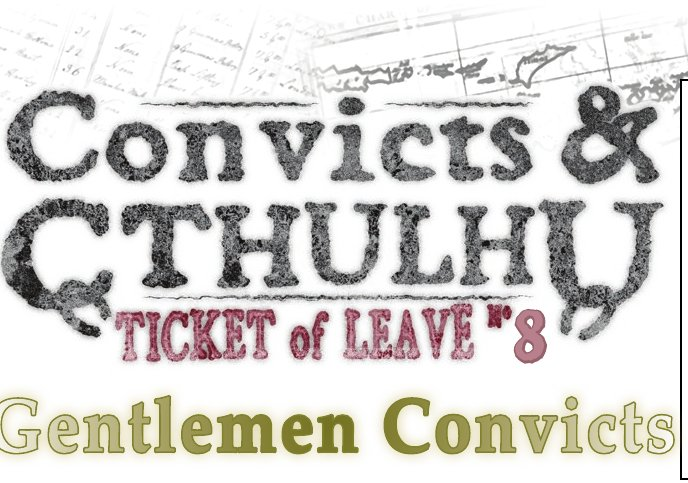
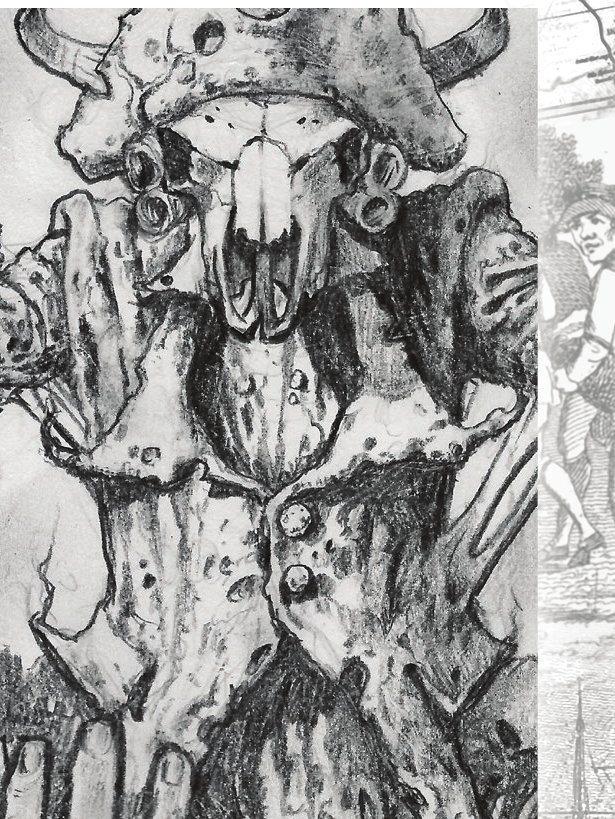

КАТОРЖНИКИ-ДЖЕНТЛЬМЕНЫ

Convicts &amp; Cthulhu — Отпускной билет № 8

*Вверху страницы — логотип «Convicts & Cthulhu — Ticket of Leave № 8» и заглавие «Gentlemen Convicts» («Каторжники-джентльмены»). Набросок сценария этого выпуска — «Джентльмен-преследователь» (с. 6).*

> «Отпускные билеты» (Tickets-of-Leave) — небольшие самостоятельные дополнения к сеттингу «Convicts & Cthulhu» для лавкрафтовских ролевых игр в ранних каторжных колониях Австралии. В каждом — подборка игровых элементов: их можно использовать все вместе как набросок мини-сценария или по отдельности — как детали, которые обогатят сценарий вашего собственного сочинения.

> **Выходные данные**
>
> «Отпускной билет» № 8 написал Джефф Гиллан (Geoff Gillan) при участии Дина Энгельхардта (Dean Engelhardt); оригинальные иллюстрации — Рубен Додд (Reuben Dodd). © 2017. Издаёт Cthulhu Reborn Publishing (www.cthulhureborn.com).
>
> Сеттинг «Convicts & Cthulhu» издаёт Cthulhu Reborn Publishing; он доступен на RPGNow и DrivethruRPG по модели «Плати сколько хочешь» (Pay-What-You-Want).
>
> Этот PDF использует товарные знаки и/или авторские права Chaosium Inc/Moon Design Publications LLC в рамках правил Chaosium для фанатских материалов (Fan Material Policy). Нам прямо запрещено брать с вас плату за использование этого материала или доступ к нему. Этот PDF не издан, не одобрен и не утверждён особо компанией Chaosium Inc. Подробнее о продукции Chaosium Inc — на www.chaosium.com.
>
> Лицензия Creative Commons BY-NC-SA.

# Вступление

Когда большинство людей слышит слово «каторжник» применительно к ранним каторжным поселениям Австралии, им сразу представляется сброд из низов английского, шотландского или ирландского общества, сосланный в колонии за какой-нибудь мелкий проступок. И подавляющее большинство каторжников, отправленных в Новый Южный Уэльс и позднее в другие австралийские колонии, были именно такими людьми — выходцами из преступных или рабочих слоёв Британии. Но не только такие каторжники высаживались на берегах антиподов: среди них были и настоящие джентльмены (а изредка и дамы) из куда более «почтенных» слоёв общества, оказавшиеся не на той стороне приговора судьи. Порой эти люди действительно были виновны в преступлениях, но не сумели с помощью богатства и положения уйти от наказания. Однако гораздо чаще эти джентльмены и дамы получали приговор скорее за то, кем они были, чем за то, что сделали. Ведь это эпоха, когда членство «не в том» движении за общественные реформы (например, в одном из тех, что добивались самоуправления для Ирландии) или просто «не те» политические взгляды или происхождение могли обернуться уголовным обвинением. А ещё, конечно, были влиятельные люди, посмевшие скрестить шпаги с другими джентльменами, чьё влияние было ещё больше, — такие стычки легко заканчивались тем, что проигравшего признавали виновным по какому-нибудь сфабрикованному обвинению и в наказание спроваживали в колонии.

Хотя на бумаге положение так называемых «каторжников-джентльменов» было ничем не лучше, чем у любого другого заключённого, на деле благодаря личному богатству они ожидали — и обычно получали — обращения куда лучшего и выгодного, чем большинство. Этот «Отпускной билет» посвящён каторжникам-джентльменам ранней каторжной эпохи: в нём есть несколько исторических примеров, а также пространный набросок сценария. В наброске сыщики оказываются втянуты в странную сверхъестественную тайну вокруг общества каторжников-джентльменов, члены которого по неосторожности навлекли на себя особенно мерзкую и неотступную угрозу Мифов Ктулху.
