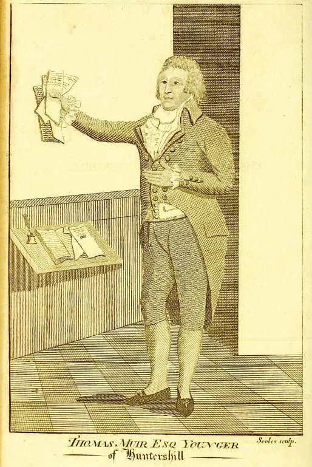

> **Шотландские мученики**
>
> Шотландские мученики принадлежали к радикальному демократическому движению, черпавшему вдохновение в (тогда ещё недавней) Французской революции. Большей частью они были выходцами из богатых семей, хотя в самом движении состояли люди всех сословий. Большинство из них сослали за подстрекательство к мятежу. Британское правительство критиковали за суровость их приговоров к ссылке, хотя стоит заметить, что это были меры военного времени — когда страх перед французским вторжением был силён, а горечь от недавней потери американских колоний ещё остра.
>
> Некоторых Шотландских мучеников поддерживали подписками политические союзники на родине: деньги собирали, чтобы те могли жить в некотором достатке, в надежде, что они продолжат политическую деятельность. Эти джентльмены и дальше вмешивались в колониальную политику — в том числе одними из первых выступали за республику.

# Пять примечательных каторжников-джентльменов

Ниже даны краткие биографические очерки пяти видных людей, относящихся к каторжникам-джентльменам. Эти люди могут пригодиться Хранителю прямо как персонажи в кампании по «Convicts & Cthulhu» или просто вдохновить его на создание похожих. Как сказано на с. 2, все исторические примеры — мужчины; вероятно, это следствие беспорядочных и непоследовательных исторических записей о жизни женщин в ту эпоху. По всей вероятности, были и богатые каторжницы, которые так же добились привилегий благодаря своему (прежнему) богатству, — просто их истории не сохранились.

Из-за немалых привилегий, которые получают каторжники-джентльмены (по крайней мере в сравнении с обычными каторжниками), игрокам может захотеться сыграть сыщиком из этого особого слоя колониального общества. Биографии ниже помогут игрокам продумать предысторию такого богатого сыщика-каторжника.

## Томас Мьюр (1765–1799)

Мьюр — шотландский политический реформатор и видный член «Шотландских мучеников» (см. рядом). Выпускник Эдинбургского университета и юрист, а также глубоко религиозный человек, он находился под влиянием идей Французской революции. Он состоял в глазговском обществе «Друзья конституции народа» (Glasgow Friends of the Constitution of the People) и в этом качестве зачитал подстрекательское обращение дублинских «Объединённых ирландцев» — единомышленников из Ирландии, — за что и был арестован. Он бежал в Париж и не явился на суд. В Англии его объявили вне закона, и он решил уехать в Америку. По пути туда он неосмотрительно заглянул к друзьям в Шотландию, где был арестован, судим и приговорён к 14 годам ссылки.

Мьюр прибыл в Сидней в 1794 году и купил небольшую ферму на берегу Сиднейской бухты (в вымышленном виде она появляется в наброске сценария из этого PDF). В 1796 году он ухитрился бежать из колонии на американском судне «Оттер» (Otter) и перебрался на испанскую канонерскую лодку, на которой добрался до испанской Калифорнии. В конце концов он отплыл в Испанию, но Британия воевала с Испанией, и он попал в бой с британской эскадрой, где лишился левого глаза; как ни прискорбно, именно поэтому британские власти
