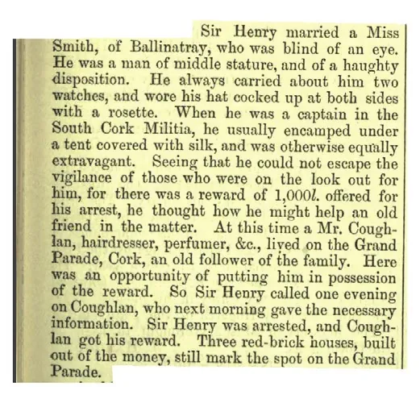

## Сэр Генри Браун Хейс (1762–1832)

Генри Хейс происходил из богатой ирландской семьи. Он был шерифом в родном Корке и капитаном ополчения; на этой службе он арестовывал тех, кого позднее сослали в Ботани-Бей. За эти заслуги его в 1790 году посвятили в рыцари. Вдовец с несколькими детьми, в 1797 году он похитил наследницу-квакершу Мэри Пайк и попытался силой заставить её выйти за него замуж. Она бежала, а его объявили вне закона. Какое-то время он скрывался, а в 1800 году решил, что объявиться уже безопасно. Он был так уверен в оправдании, что сам сдался суду. Его признали виновным и приговорили к смерти, но казнь заменили пожизненной ссылкой.

Хейс отплыл в Сидней в 1802 году и щедро заплатил за привилегированное место на судне (правда, из-за этой каюты он поссорился с судовым хирургом и избил его, за что по прибытии в Сидней Хейса на полгода посадили в тюрьму). В Сиднее он сошёлся с Морисом Маргаро (см. выше) и другими, и его заподозрили в причастности к восстанию у Касл-Хилл (оно же восстание у Винегар-Хилл) 1804 года, за что, несмотря на отсутствие твёрдых улик, его повторно сослали на Землю Ван-Димена. В 1805 году он получил там земельный надел, а в 1808 году вернулся в Сидней.

В Сиднее Хейс поселился в Воклюз-хаусе (Vaucluse House) в Саут-Хеде, на землях кадигалов, — дом стоит и поныне. Однако в 1808 году Хейса за сочувствие Блаю приговорили к работам на угольных копях Ньюкасла, хотя в 1809 году он вернулся, чтобы ответить на обвинение в насмешках над мятежной администрацией. Блай помиловал Хейса, и это помилование признал следующий губернатор, Маккуори. В 1812 году Хейс отплыл обратно в Ирландию, пережил кораблекрушение и поселился в Корке, где и прожил до смерти в 1832 году.

Хейс известен тем, что в 1803 году основал в Сиднее первую масонскую ложу, хотя за это его и посадили в тюрьму, поскольку это шло наперекор приказу губернатора Кинга. Он слыл человеком вспыльчивым, привыкшим решать вопросы кулаками, и жил на широкую ногу, несмотря на положение каторжника.

**Источники:** живой рассказ о жизни Хейса — http://www.sirhenrybrownehayes.com/foreword.html, а также http://adb.anu.edu.au/biography/hayes-sir-henry-browne-2172

> **Газетная заметка (перевод)**
>
> Сэр Генри женился на мисс Смит из Баллинатрея, слепой на один глаз. Он был среднего роста и надменного нрава. Он всегда носил при себе двое часов, а шляпу заламывал с обеих сторон и украшал розеткой. Будучи капитаном Южнокоркского ополчения, он обычно располагался лагерем под шатром, крытым шёлком, и во всём прочем был столь же расточителен. Видя, что ему не ускользнуть от бдительности тех, кто его выслеживал, — ведь за его арест была назначена награда в 1000 фунтов, — он рассудил, как бы при этом помочь старому другу. В то время на Гранд-Парейд в Корке жил некий мистер Кофлан, цирюльник, парфюмер и т. д., давний приверженец семьи. Вот и случай отдать ему награду. И вот однажды вечером сэр Генри зашёл к Кофлану, а тот наутро сообщил куда следует нужные сведения. Сэра Генри арестовали, а Кофлан получил награду. Три дома красного кирпича, построенные на эти деньги, до сих пор отмечают то место на Гранд-Парейд.

## Джон Грант (1776–?)

Один из первых поэтов Австралии, Грант был также политическим агитатором. Он выстрелил в семейного стряпчего, стоявшего на пути его ухаживаний за дочерью лорда Дадли и Уорда, и за это преступление был приговорён к смерти. Его сестра успешно подала прошение дочерям короля Георга III, и казнь заменили пожизненной ссылкой.

Он прибыл в Новый Южный Уэльс в 1804 году и, хотя тяжело переносил положение каторжника, обращались с ним хорошо. Однако он сошёлся с Генри Брауном Хейсом (см. выше) и в 1805 году написал памфлет против губернатора Кинга. За это его повторно сослали на остров Норфолк, где с ним обращались сурово. Он пытался бежать и открыто критиковал коменданта, капитана Пайпера. За эти проступки его подвергли одиночному заключению — высадили на соседний необитаемый остров. Через четыре месяца его забрали оттуда, но его телесное и душевное здоровье было подорвано. В 1808 году его отправили обратно в Сидней, и он служил капелланом в Ньюкасле. Губернатор Маккуори помиловал его в 1811 году, и он уехал в Англию. Подробности его смерти неизвестны.

Письма и дневники Гранта нашли лишь недавно; теперь они хранятся в Национальном архиве Австралии и служат ценным источником о периоде 1804–1811 годов.

**Источники:** http://adb.anu.edu.au/biography/grant-john-2118, а также книга «This Beauteous and Wicked Place: Letters and Journals of John Grant, Gentleman Convict» («Это прекрасное и порочное место: письма и дневники Джона Гранта, каторжника-джентльмена»), National Library of Australia (2000, под ред. Ивонн Крамер / Yvonne Cramer).
