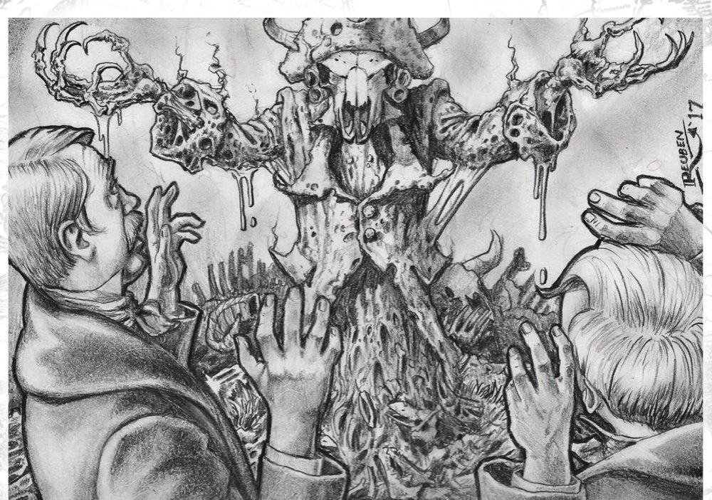

В другой главе затхлого фолианта Уолтон прочёл об изготовлении «магических заместителей» — изображений, в которые можно на время поместить частицу жизненной сущности человека. Такие заместители могут подменять участников при совершении ритуальной магии.

Так Гринсли и Уолтон взялись за изготовление набора ритуальных заместителей — каждый представлял собой глиняную бутылку, которой грубо придали сходство с одним из членов Просвещённых братьев. В каждую бутылку-заместитель поместили немного крови соответствующего человека — эта связь наделяла её частицей его сущности. Собрать эти маленькие кровавые образцы без ведома и согласия намеченных братьев было нелегко. Но благодаря череде мелких «случайностей и происшествий», подстроенных Гринсли и Уолтоном, задачу удалось выполнить всего за несколько недель. Всего двое сделали шесть таких бутылок — достаточно, как они надеялись, чтобы покрыть требование заклинания (рассудив, что не все члены тайного общества непременно «чистой крови»).

Вооружившись бутылками-заместителями, а также ещё одним магическим «артефактом» — древней на вид жаровней, покрытой резьбой странных знаков, — двое были готовы совершить ритуал. Церемония требовала большого количества жертвенного «материала» — плоти, живой или мёртвой. К счастью, благодаря невинным расспросам среди братьев Гринсли свели с неисчерпаемым источником такого вещества — бойней мясника из Рокса по имени Джордж Крибб. Пробравшись однажды поздно ночью на пропитанный миазмами двор и встав перед костяной ямой, куда сбрасывали бесчисленные части туш животных, двое совершили свой ритуал.

### Человек в синем сюртуке

То ли потому, что их наспех слепленный ритуал был ошибочен, то ли просто потому, что «звёзды не встали как надо», попытка Гринсли и Уолтона призвать Йог-Сотота провалилась. Но церемония не прошла совсем бесследно — вместо того чтобы привлечь внимание Внешнего бога, ритуал, проведённый этой парой, привёл в костяную яму на бойне Джорджа Крибба нечто совсем иное. Оно поднялось из гниющей плоти животных, связав разрозненные рога, шкуры и жилы в омерзительное подобие человека. Внешне это ужасающее сверхъестественное существо чем-то напоминало старомодного
