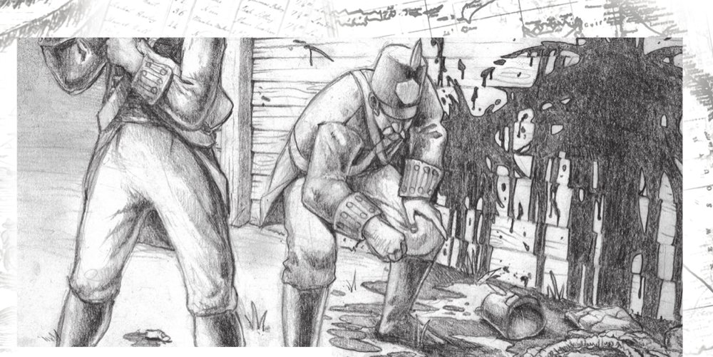

## Расследование о тайном обществе

Значительную часть приключения сыщики проведут, разыскивая членов Просвещённых братьев и беседуя с ними, — пытаясь сложить воедино подробности убийств и того, что каждый из них мельком видел жуткого преследователя. Дело осложнится тем, что члены общества будут время от времени погибать.

### Энтони Вудхаус (мёртв)

К началу сценария Вудхаус уже мёртв. Тем не менее кое-какие подробности сыщики могут почерпнуть, расспросив его соседей, местные власти и других знавших его людей.

- У Вудхауса был дом в Парраматте, рядом с военными казармами.
- Местный констебль Парраматты считает, что Вудхауса загрызли дикие собаки динго.
- Хотя никто из горожан не видел человека в синем сюртуке, неряшливый капрал из казарм Парраматты утверждает, что в ночь преступления видел, как ему показалось, флотского офицера, околачивавшегося в городе. (Флотские офицеры по традиции носили синие мундиры.) Капрал собирался пойти подраться с ним за то, что тот посмел за ним увязаться, но свалился пьяным, не успев дойти. У него есть дикие теории о флотских офицерах, подкрепляющие безумные предположения о том, зачем кому-то из них там бывать.
- Обыск дома покойного: это опрятный фермерский дом с тремя слугами, которые в ночь его смерти все ушли выпивать. (Как каторжнику, ему не распределяют других каторжников, но, будучи богатым, он мог позволить себе нанимать работников.) Ни следов оккультной деятельности, ни следов взлома в доме не найти.
- Ужасный запах: неважно, придут ли сыщики сразу после смерти Вудхауса или через неделю, — запах бойни всё ещё висит над этим местом.
- Две мелочи, которые можно заметить в доме (при успешной проверке подходящего навыка):
    - В камине лежит маленькая повязка с пятнышком крови от какой-то ранки.
    - По комнате, где он умер, разбросано несколько маленьких костей животных; если их осмотреть, окажется, что это кости поросят и козлят.

### Фрэнсис Уолтон (безумец)

К началу сценария Уолтон заключён (и находится в оцепенении) в маленькой тюрьме рядом с военными казармами в Сиднее. Он второй, кого убивает Человек в синем, — его убивают в камере.

- Внезапное безумие Уолтона никому не кажется особенно примечательным: в Новом Южном Уэльсе с ума сходит столько людей, что об этом едва ли стоит много расспрашивать.
