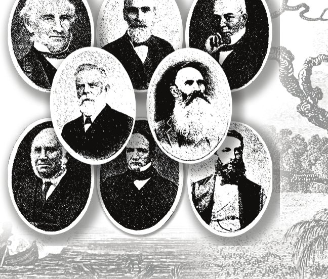

(где, без его ведома, сейчас прячется Гринсли — см. с. 17).

**Беседа с Лайлом:**

- Если сыщики спросят, что, по мнению Лайла, происходит: у него есть теория, что Гринсли разгневал в Лондоне какую-то группу знати вроде «Клуба адского пламени» и, возможно, выдал их тайны. Кто-то в Сиднее, связанный с этой группой, считает, что Гринсли разболтал те же тайны своей новой группе — Просвещённым братьям. И вот какой-то каторжник или иной негодяй взялся убивать Просвещённых братьев и принимает этот ужасающий облик в назидание другим.
- Если спросить об «оккультных склонностях» тайного общества: Лайл отметает любые такие предположения, замечая, что подобной чепухой интересовался только Гринсли. Да и оккультизм этого человека, по мнению Лайла, был не более чем «вредной дребеденью, которой он себя развлекал, а мы терпели».
- Если спросить, не получал ли он недавно мелких порезов или чего-то подобного, Лайл сначала ответит отрицательно, а через несколько мгновений вспомнит один незначительный случай: несколько недель назад Уолтон уколол его иглой — нелепая случайность, когда игла застряла в шляпе Лайла.
- Убийство Лайла: в ночь гибели его гнусно уродуют, словно кто-то оскорбился его теориями.

### Томас Хогг (отечески спокоен)

Хогг — глубоко религиозный пожилой шотландец и мыслитель-философ. В отличие от большинства других членов Просвещённых братьев, Хогг не считает, что Человек в синем сюртуке ему чем-то угрожает. Он живёт в старом доме в центре Сиднея, недалеко от Дома правительства. Дом опасно обветшал. Вместе с ним живёт служанка Энни Беддоуз, 20 лет, каторжница с отпускным билетом, которая живёт в колонии с отрочества. Она заботится о его домашних нуждах, но никаких отношений, кроме отеческой привязанности, между ними нет.

**Беседа с Хоггом:**

- Если спросить об оккультных обрядах (или о странных убеждениях Гринсли и его «прихвостня» Уолтона): Хогг крайне зол на Гринсли и Уолтона за то, что считает сатанинскими практиками.
- Если спросить о безумии Уолтона и череде убийств: он считает, что Уолтон всегда был не в себе, а убийства — это ссора среди кучки горе-джентльменов, показавших себя продажными мошенниками.
- Особенно наблюдательные сыщики могут (при успешной проверке подходящего навыка) заметить на руке Хогга подсохший порез. Если спросить о нём, Хогг скажет, что, похоже, поранился во сне. Он винит грубые деревянные планки кровати, на которой спит.
- Убийство Хогга: в ночь, когда его убивают, Хогг бросается на нападавшего и кричит Энни, чтобы та бежала. Благодаря этому она остаётся жива, но к тому времени, как она приводит солдат из Дома правительства, шотландец уже мёртв.
- Рассказ Энни: если спросить её о пережитом при встрече с Человеком в синем сюртуке, служанка опишет нападавшего не как человека, а как чудовище с костяным лицом и когтями. Она говорит, что, хотя оно и походило на человека в сюртуке, одежда была вовсе не из ткани, а из какой-то омерзительной кожи, похожей на дублёную шкуру.

