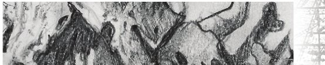

что может поднять из костяной ямы такое баловство со сверхъестественным.

- **Слабость Человека в синем.** Как отмечено в игровых характеристиках Человека в синем сюртуке, он почти неуязвим для обычного оружия, но у него есть одна главная слабость — оружие из кости животных. Навести сыщиков на это можно многими способами:
    - через отрывок из Книги Мифов Гринсли;
    - через безумные кровавые надписи, оставленные Фрэнсисом Уолтоном на стене тюремной камеры;
    - через рисунки снов Уильяма Чаффи;
    - через безумное озарение, полученное сыщиком, у которого случится приступ безумия.

## Ключевые места

Кроме домов и ферм Просвещённых братьев, в сценарии могут оказаться важны ещё несколько мест.

### Ферма Мьюра

Ферма Мьюра — небольшой, слегка обветшавший домик с единственной хозяйственной постройкой. В домике никто не жил с тех пор, как его покинул Томас Мьюр. От него веет заброшенностью, но он не совсем развалился: правда, пашня теперь заросла, а постройка нуждается в починке. Сейчас в домике живёт Гринсли. У него несколько деревянных ящиков и мешков из-под зерна с едой, ромом и книгами, чтобы продержаться. По ночам свет его фонаря то и дело мерцает сквозь заросли, но большую часть времени он старается его прикрывать.

### Костяная яма в Роксе (бойня Джорджа Крибба)

Джордж Крибб — мясник, который работает в Роксе и держит там частное мясное дело. [Это реальное историческое лицо.] Главное в заведении Крибба — большая скотобойня. Задний двор участка в Роксе отведён под костяную яму: в песчанике вырыта большая яма, куда сбрасывают отходы — кости, рога, конечности и прочие остатки — тысяч забитых животных.

Как отмечено выше, это место обрело особое оккультное значение благодаря решению Гринсли провести здесь свою попытку призыва. В костяной яме лежит «сырьё», из которого Человек в синем сюртуке поднимается каждую вторую ночь.

# Варианты Мифов

Предлагаются три альтернативные тайны, связанные с Мифами. Хранитель может решить, какую из них использовать. Каждая в чём-то повлияет на то, как разыграются ранние части приключения, — а также его великий финал.

## Вариант A: Охотник из прошлого

При этом варианте «Человек в синем сюртуке» на самом деле — сверхъестественное существо, чей облик основан на фигуре из личного прошлого двух членов Просвещённых братьев — Хогга и Гринсли. Десятилетия назад оба провели какое-то время в дореволюционном Париже, где оба (независимо друг от друга) были знакомы с человеком по имени Харланд Дрейк. Когда Францию захлестнула революция, Дрейк навлёк на себя гнев кое-кого из самых жестоких революционеров. Будучи тогда влиятельными людьми в Британии, и Хогг, и Гринсли имели возможность спасти бывшего друга — но ни один ею не воспользовался, и в итоге Дрейк окончил жизнь на гильотине.

Когда попытка призвать Йог-Сотота с треском провалилась, она вместо этого вызвала ужасный источник отрицательной силы и сплавила его с психической ненавистью Дрейка, витавшей вокруг двух каторжников-джентльменов. Так и был создан Человек в синем сюртуке. Теперь тварь стремится уничтожить всех, кто связан с Хоггом и Гринсли. Особенно она охотится на тех, кто участвовал в церемонии, но уничтожит и всех прочих, кого сочтёт их «союзниками». Со временем к ним могут причислить и сыщиков.

