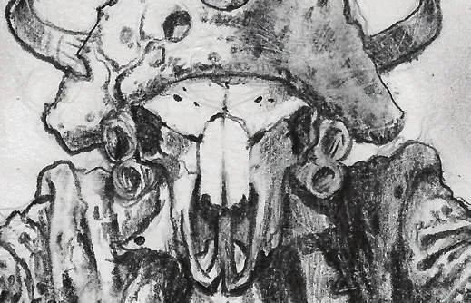

существо, чья единственная цель — учинить как можно больше резни. Ужас и страдания, порождённые такими делами, перетекают обратно в Книгу и поддерживают её существование.

**Дополнительные улики:**

- При этом варианте Книга не у Гринсли — её находят среди вещей Уолтона (вероятно, после его гибели).
- Гринсли вообще не хочет говорить с сыщиками о Книге, опасаясь (и справедливо), что она его обманула, и страшась той власти, которую она ещё может над ним иметь. Однако после четырёх смертей он сдастся и в отчаянии свяжется с сыщиками, чтобы поделиться подозрениями и страхами.
- Сыщики, сведущие в Истории или Оккультизме, могут (при успешных проверках) выяснить кое-что о любопытном прошлом Книги как реликвии.
- Старое письмо в доме Гринсли, который он теперь бросил, упоминает Книгу и слух, что она — ловушка: на полях Гринсли написал «чепуха!».

**Развязка.** Как только Книга оказывается в руках сыщиков, она зовёт их: во сне они слышат голоса и при проваленной проверке Силы воли (МОЩ в играх на основе BRP) ощущают непреодолимое желание провести заклинание «Призыв твари в яме». Используйте заклинание из описания Гринсли ниже или переделайте заклинание вроде «Призыва служителя», добавив требование костей и других частей тела и крови более чем трёх призывателей. Если у них получится, Тварь будет выслеживать и убивать их одного за другим, пока её не уничтожат. Если уничтожить книгу, Тварь тоже будет уничтожена навсегда.

*Прим. перев.: здесь заклинание названо «Summon Thing in the Pit» («Призыв твари в яме»), а в статблоке Гринсли — «Summon Thing from the Bone Pit» («Призыв твари из костяной ямы»); это одно и то же заклинание.*

# Характеристики

Ниже приведены игровые характеристики для 7-й редакции «Зова Ктулху».

### Сарум Гринсли

*Лживый наниматель и осуждённый мелкий дворянин, 59 лет*

```stat
СИЛ 40    ВЫН 40    ТЕЛ 60    ЛВК 60    ИНТ 90
НАР 70    МОЩ 80    ОБР 85    Рассудок 15    ПЗ 10
БкУ: нет    Комплекция: 0    Скорость: 8    ПМ: 16

Драка        50% (25/10), урон 1d3 + БкУ
Заточка      50% (25/10), урон 1d4 + БкУ
Уклонение    40% (20/8)

Навыки: Мифы Ктулху 15%, Средства 45%, Проницательность 65%, Оккультизм 40%,
Скрытность 55%.

Заклинания: Призыв твари из костяной ямы.
```

**Призыв твари из костяной ямы.** Заклинание требует совместного ритуала по меньшей мере трёх призывателей или 50 пунктов магии, а также крови каждого участника ритуала. Для ритуала нужны кости по меньшей мере двух крупных животных или человека — из них и составляется существо. Тварь призывается в течение 8 часов после завершения ритуала. Лишь кажется, что Тварь во власти Призывателя, — на самом деле она подчиняется странной и непостижимой воле сил, которые её создали.

### Человек в синем сюртуке (он же Тварь из костяной ямы)



Это омерзительное существо каждую вторую ночь поднимается из костяной ямы на бойне Джорджа Крибба, чьи отбросы дают ему тело и одежду. Его одежда похожа на синий плащ, костюм и треуголку. Это не ткань, а кожа и шерсть мёртвых животных, забитых на соседнем дворе и сброшенных в яму. Лицо твари — коровий череп, пустые глазницы которого не оживляет ничто похожее на жизнь. На каждой руке у неё длинные когти, которыми она нападает и, когда пожелает, вынимает органы. Она не говорит, но может издавать визг, похожий на крик умирающих животных.

```stat
СИЛ 100   ВЫН 80    ТЕЛ 90    ЛВК 50    ИНТ 25
МОЩ 65    ПЗ 17
БкУ: +1d6    Комплекция: 2    Скорость: 8    ПМ: 13
```
