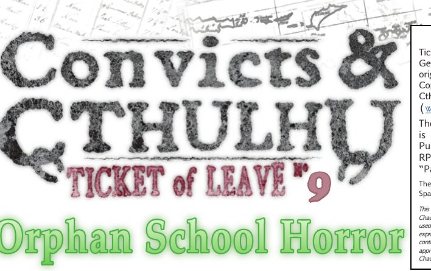
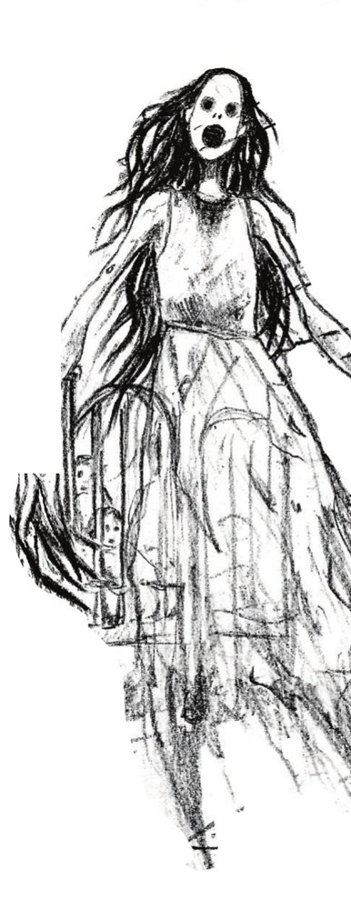

УЖАС СИРОТСКОЙ ШКОЛЫ

Convicts &amp; Cthulhu — Отпускной билет № 9

*Вверху страницы — логотип «Convicts & Cthulhu — Ticket of Leave № 9» и заглавие «Orphan School Horror» («Ужас сиротской школы»). Набросок сценария этого выпуска — «Ужас сиротской школы» (с. 7).*

> «Отпускные билеты» (Tickets-of-Leave) — небольшие самостоятельные дополнения к сеттингу «Convicts & Cthulhu» для лавкрафтовских ролевых игр в ранних каторжных колониях Австралии. В каждом — подборка игровых элементов: их можно использовать все вместе как набросок мини-сценария или по отдельности — как детали, которые обогатят сценарий вашего собственного сочинения.

> **Выходные данные**
>
> «Отпускной билет» № 9 написали Джефф Гиллан (Geoff Gillan) и Дин Энгельхардт (Dean Engelhardt); оригинальные иллюстрации — Рубен Додд (Reuben Dodd). © 2017. Издаёт Cthulhu Reborn Publishing (www.cthulhureborn.com).
>
> Сеттинг «Convicts & Cthulhu» издаёт Cthulhu Reborn Publishing; он доступен на RPGNow и DrivethruRPG по модели «Плати сколько хочешь» (Pay-What-You-Want).
>
> Ллойгоров придумал Колин Уилсон; Пожирателей извне (Space Eaters) — Фрэнк Белнап Лонг.
>
> Этот PDF использует товарные знаки и/или авторские права Chaosium Inc/Moon Design Publications LLC в рамках правил Chaosium для фанатских материалов (Fan Material Policy). Нам прямо запрещено брать с вас плату за использование этого материала или доступ к нему. Этот PDF не издан, не одобрен и не утверждён особо компанией Chaosium Inc. Подробнее о продукции Chaosium Inc — на www.chaosium.com.
>
> Лицензия Creative Commons BY-NC-SA.

# Вступление

Немало написано о жизни каторжников-мужчин, военных и вольных поселенцев в ранних каторжных колониях Австралии. Сохранилось и изрядное число рассказов о жизни женщин. Однако одна тема редко привлекает внимание — жизнь детей в каторжных поселениях. Легко вообразить, что в месте, задуманном как суровое место наказания, детей почти не было, но на деле это не так. Дети попадали в колонии сыновьями и дочерьми богачей; другие прибывали детьми-каторжниками. Третьи рождались в долгом плавании из Британии или были незаконными плодами союзов каторжников с каторжницами — или каторжников с тюремщиками.

Ко времени сеттинга «Convicts & Cthulhu» из примерно 7000 душ населения Нового Южного Уэльса около 1800 составляли дети европейского происхождения. Лишь около 800 из них были законнорождёнными.

Обилие детей — особенно нежеланного потомства каторжников — доставляло колониям немало хлопот: ни родители, ни правительство не могли позволить себе кормить и одевать их. Отсюда довольно неприглядное явление — множество брошенных бездомных беспризорников, живших на улицах. По большей части колониальное правительство той эпохи бессердечно закрывало глаза на эти страдания… но было одно заметное исключение — Школа для девочек-сирот. Её открыли в 1801 году именно для того, чтобы убрать с улиц беспризорных или оставшихся без родителей девочек и дать им образование (худо-бедно). Эта (смутно благотворительная) школа-пансион — самая ранняя попытка выработать казённый подход к обездоленным… а сочетание в ней суровой дисциплины с юными «невинными» делает её любопытным фоном для мрачных историй ужаса. Это особенно подходящая обстановка для личных историй ужаса, которые, как жуткий испанский фильм ужасов 2007 года «El Orfanato» («Приют»; http://www.imdb.com/title/tt0464141/), вращаются вокруг сверхъестественных ужасов, рождённых страданиями детей.

Этот «Отпускной билет» даёт обзор первой Сиднейской школы для девочек-сирот, а также призрачное приключение в самой школе и вокруг неё. Поскольку (для современного восприятия, сложившегося много позже эпохи каторжников) истории о призраках и сиротских приютах естественно связаны с Рождеством, этот «Отпускной билет» приурочен к выходу на Рождество 2017 года. Впрочем, на деле сценарий можно поместить в любое время года.
