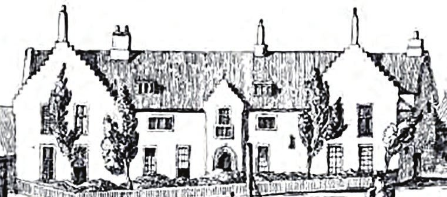

Некоторых девочек школа оставляет у себя прислугой, в том числе помощницами на кухне; такое ученичество может начаться с 8 лет. Обычно оно длится 5 лет.

Помимо этих видов работы, девочки Школы для девочек-сирот могли зарабатывать для школы, продавая ткани и одежду, сделанные ими на уроках. Такие товары школа иногда продаёт местным купцам… хотя девочек, пытавшихся получить личный доход, продавая плоды своего труда прямо лавочникам, жестоко наказывали.

## Выход из школы

Девочки покидают школу пятью путями:

1. когда им исполняется 16 лет;
2. если они поступают в ученичество;
3. если их забирает обратно родитель, который прежде был нищим или отсутствовал, но теперь может их содержать;
4. если они выходят замуж (это возможно только с согласия комитета);
5. если они сбегают.

В последнем случае беглянок всегда разыскивают власти и (найдя) возвращают в Школу для девочек-сирот для наказания.

Девочкам, выходящим замуж прямо из школы, дают 10 фунтов стерлингов как своего рода приданое… хотя в позднейшие годы эти деньги заменили выдачей скота (отсюда обычай, что невеста получает «свадебную корову», чтобы обзавестись хозяйством).

Детей школа никогда не отдаёт на усыновление.

## Для чего ещё служило здание школы?

Как большое здание, принадлежащее казне, Школа для девочек-сирот рассматривалась колониальным правительством и как место, пригодное для других целей — особенно тех, где нужен большой зал, в котором могут собраться люди. Большую часть эпохи «Convicts & Cthulhu» в Сиднее нет отдельного здания церкви (из-за задержек с её финансированием и постройкой). Тем временем главный класс Школы для девочек-сирот служит местом, где каждое воскресенье проходят службы Англиканской церкви. Эти службы обычно посещает большая часть высших кругов сиднейского общества, заполняя скромный «зал» до отказа. Присутствие девочек-сирот на воскресных службах обязательно.

Класс иногда использует и колониальное правительство как место для крупных уголовных или гражданских судов, где ожидается множество людей (как свидетелей или просто зрителей). Особенно события эпохи Блая заставляют призывать Школу для девочек-сирот к такой службе с пугающей частотой — сначала как место суда над Джоном Макартуром, а позже — после военного мятежа, Ромового бунта 1808 года, — как «суд-самосуд», где судили и выносили приговоры тем, кто остался верен низложенному губернатору.
