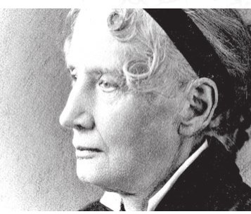

…расследование призраков школы (подробнее — «Ложные следы и другие осложнения» на с. 15).

## Истинная природа угрозы

Истинная сверхъестественная угроза за странными явлениями, о которых рассказывают ученицы и персонал, зависит от того, какой из вариантов выбрал Хранитель (см. «Варианты Мифов» на с. 15).

- **Вариант A — Трещина в реальности.** В этой версии призраков в школе вызывает обломок огромного и ужасного ллойгора, заточённого в водной темнице где-то в другом месте, но связанного с этим местом мистическими вратами, погребёнными под школой. Из-за подвижки фундамента здания школы врата впервые за тысячелетия оказались открыты человеческой мысли.
- **Вариант B — Средоточие нужды.** В этой версии ужас, преследующий школу, — сверхъестественное живое воплощение страданий детей, с которыми дурно обращаются; он питается этим горем, становясь сильнее, с целью обрести телесную форму, чтобы самому продолжать жестокость к юным. Это вариант «рождественских призраков».
- **Вариант C — Гость капитана Кента.** В этой версии призраков в школе вызывает жуткое сверхъестественное существо (зачаточная форма межзвёздной расы, которую иногда называют Пожирателями извне). Это чудовище несколько лет назад призвал на землю опустившийся морской офицер, гостивший в доме капитана Уильяма Кента — в здании, которое теперь занимает школа.

## Беседа с миссис Патерсон

Если сыщиков привлекают через официальное обращение Комитета Школы для девочек-сирот, знакомство с тайной произойдёт в беседе с миссис Патерсон — трезвомыслящей женой военного, деятельным членом комитета. Она хорошо известна в колонии своей преданностью делу, трудолюбием и решительностью. Если Хранитель переделывает сценарий, ему нужно позаботиться о том, чтобы сведения ниже были переданы иными способами.

Миссис Патерсон знает следующее:

- Последние три недели дети Школы для девочек-сирот видят «странные призраки». Одни девочки говорят, что видели «призрачного ребёнка», другие — призрачную экономку. Об этом рассказали около десяти детей разного возраста, примерно от 4 до 14 лет. Смотритель и надзирательница школы были склонны списать это на разыгравшееся воображение или, может быть, какую-то болезнь… пока не случились два недавних события.
- Первое недавнее событие — необъяснимое (и небывалое) «беспамятство», поразившее двух учениц. Обеих девочек охватило душевное оцепенение: они не могут ни говорить, ни двигаться. [Примечание для Хранителя: миссис Патерсон описывает кататонию, но такого медицинского понятия ещё не существует.]
    - Одна из двух поражённых так девочек — Мэри Аскер, 9 лет; спустя несколько дней она всё ещё не откликается.
    - Другая девочка, впавшая в «беспамятство», — Бетани Смолл, 13 лет; её поразило так же, но через девять дней она вышла из оцепенения. Учительницы школы (и даже надзирательница) расспрашивали Бетани, но она мало что помнит о случившемся, кроме того, что это как-то связано с призрачной фигурой и с чем-то, отчего она до сих пор приходит в сильное возбуждение и страх. Попытки узнать у ребёнка больше затруднены: её стали охватывать непредсказуемые приступы страха.
