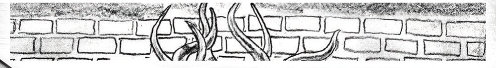

- …Колониальный хирург осматривал обеих девочек, но его лечение мало что прояснило. Он поставил пиявки, чтобы отвести лишние соки, которые, по его мнению, и вызывают возбуждение Бетани, но в остальном не нашёл у девочки никакого недуга. Точно так же его осмотр всё ещё не откликающейся Мэри не смог вывести её из этого состояния.
- Второе событие, привлёкшее внимание смотрителя и надзирательницы, — за последние четыре дня пропали двое из персонала школы. Обе — каторжницы, которые работали вместе с персоналом школы, помогая с девочками. Одна — миссис Маргарет Бойн, 32 лет, замужем за садовником с сиротской фермы; другая — Гарриет Торренс, 22 лет, молодая женщина, которая недавно ушла с распределения, где была домашней прислугой у фермера в Парраматте.
    - Сиднейские власти извещены об исчезновении женщин, но считают, что те, вероятно, просто сбежали. Миссис Патерсон считает это маловероятным: обе женщины добропорядочны и ничего бы на этом не выиграли.

*Прим. перев.: здесь сказано, что женщины пропали «за последние четыре дня», а во «Вступлении для Хранителя» (с. 8) — что одна две недели назад, другая на прошлой неделе; так в оригинале, Хранитель выбирает сам.*

Сообщив эти сведения, миссис Патерсон поручает сыщикам разобраться в деле от имени Комитета и выяснить, что пугает девочек и где искать пропавших женщин. Она очень практичная женщина и считает истории о призраках и привидениях сплошными выдумками, но явно что-то затевается.

Если сыщики спросят её мнения (а может быть, и не спрашивая), она скажет, что подозревает какого-то гнусного мужчину, который околачивается поблизости и пристаёт к девочкам, но признаёт, что персонал, похоже, ни о ком таком не сообщал.

В конце беседы миссис Патерсон даёт им письмо-полномочие от Комитета и соглашается, что Комитет возместит все расходы по предъявлении счетов.

## Ход приключения

Этот сценарий задуман так, чтобы разворачиваться как классическая «история о призраках». В таких историях обычно много медленного, атмосферного нагнетания и сравнительно мало прямых столкновений (по крайней мере до самого конца истории, когда герои начинают догадываться, с каким ужасом имеют дело). Поэтому ход сценария, скорее всего, будет таким:

1. Первая встреча с миссис Патерсон.
2. Первые расспросы о Школе для девочек-сирот и первые беседы с персоналом.
3. Обыск здания школы в поисках следов странного; тогда сыщики и встретят первые мелкие сверхъестественные явления.
4. Более подробное расследование — в школе или в окрестностях, — которое в конце концов приведёт к пониманию природы Ужаса.
5. Последнее столкновение, когда сыщики попытаются изгнать тварь.

## Первые расспросы

Сыщики, которые станут расспрашивать в Сиднее о репутации Школы для девочек-сирот или иным путём собирать сплетни о заведении, услышат два противоречащих друг другу мнения. Друзья губернатора считают её образцом добропорядочности и ценным учреждением, а политические враги утверждают, что она немногим лучше борделя. Известно, что вокруг школы околачивались и докучали кое-какие сомнительные личности, однако преобладающее мнение колонистов (мужчин) таково, что в подобном скорее виноваты сами «непутёвые девчонки» из приюта. Общее мнение — они нравственно испорчены и потому, естественно, привлекают внимание мужчин низких нравов.

Собрать кое-какие основные фактические сведения о Школе для девочек-сирот из колониальных записей легко.
