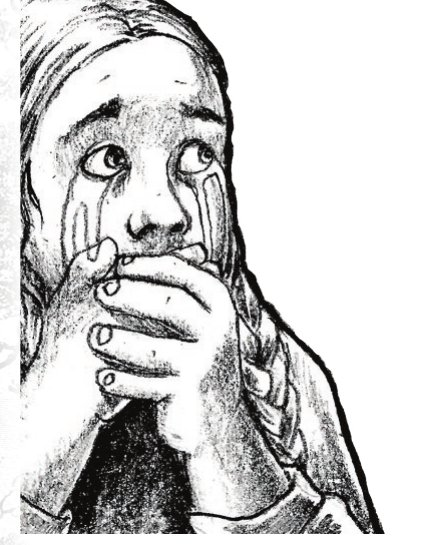

Так сыщики могут узнать:

- Школа для девочек-сирот размещается в здании, которое прежде было домом капитана Уильяма Кента, племянника губернатора Хантера. Это здание называли «лучшим домом во всём Сиднее».
- Школа стоит на участке, ограниченном Джордж-стрит и Филип-стрит; с востока — Танк-Стрим.

Придя в школу, сыщики очень легко увидят общее устройство здания (подробнее — на карте на с. 13):

- Это красноватое двухэтажное здание с двумя крыльями, одно новее другого: так здание выросло вдвое против первоначального. В нём несколько спален, жилые комнаты и кухня. В старом крыле на первом этаже — кабинет, а под ним — слегка перекошенный подвал.
- По обе стороны от главного здания — надворные постройки, а перед ним — десять огородных грядок.
- Приют окружает основательная стена толщиной 45 см и высотой 2,7 м. Прямо за стеной, внутри, — площадка для игр.
- Если используется (необязательная) рождественская обстановка, здания украшены скудными рождественскими украшениями.

Сыщики, скорее всего, захотят поговорить с персоналом школы и выслушать их рассказы; как описано выше, персонал обычно состоит из надзирательницы и смотрителя, которые ведут повседневные дела школы, и горстки учительниц (обычно старших девочек-каторжниц или каторжниц). Кроме того, сейчас здесь трое слуг — две женщины (кухарка и экономка) и один мужчина (привратник). Учительницы и слуги будут только рады поговорить с сыщиками — недавние события ставят их в тупик, — однако излишняя болтовня навлечёт гнев надзирательницы, которая презирает и сплетни, и праздность. Сведения, которые можно узнать в беседах, сведены ниже.

Сыщики, возможно, захотят поговорить прямо с девочками-сиротами, но надзирательница поначалу запретит любые такие расспросы — особенно если в группе сыщиков в основном мужчины. Однако по ходу событий она смягчится (что можно узнать, расспрашивая учениц, — см. «Расспросы девочек» на с. 14).

### О пропавших служанках

- Обеих пропавших каторжниц вспоминают как трудолюбивых и хороших работниц. Все потрясены тем, что женщины исчезли.
- Предположение, что пропавшие женщины, возможно, стали жертвой злодейства, приводит персонал школы в ужас — однако если спросить, кто мог бы совершить такое преступление, кое-кто из персонала упомянет грубых мужчин, работающих на соседнем складе (которым заправляет мистер Андервуд). Народ там, похоже, сомнительный.
- Одна из работниц вспоминает, что в последний раз Гарриет видели в подвале старого крыла.

### О «впавших в беспамятство» и не откликающихся девочках

- Персонал очень сочувствует девочкам, впавшим в оцепенение.
- Большинство персонала и старших девочек считают, что их напугали до такого состояния — вероятно, какой-то странный мужчина.

### О призрачных явлениях

- Хотя они слышали истории, которые рассказывают сироты, никто из персонала сам не видел фигур «призрачных детей».
- Однако кое-кто из домашней прислуги мельком видел призрачные взрослые фигуры. Две женщины, видевшие такое явление (Элизабет Бин и Кэролайн Мерчант), описывают его как призрачную фигуру женщины. Каждая лишь мельком видела фигуру, но описывает её как статную женщину, призрачную и слегка зеленоватую, которая проплывала мимо и манила, будто приглашая за собой. Обе почувствовали непреодолимое желание пойти за ней, но устояли.
- Если сыщики спросят, где обе служанки пережили эти встречи, Элизабет скажет, что видела призрачную женщину у верхней спальни нового крыла. Кэролайн видела призрачную фигуру у кабинета смотрителя в старом крыле.

