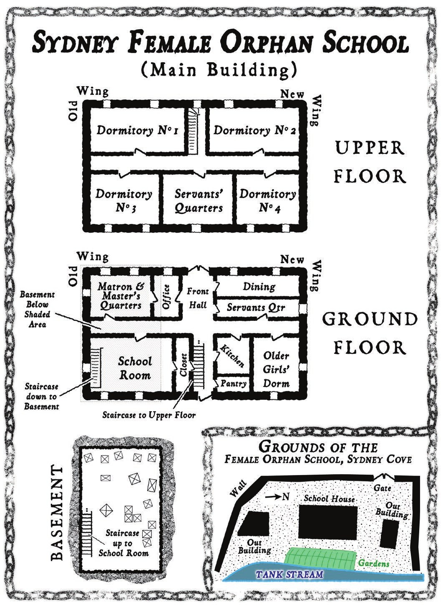

## Устройство Сиднейской сиротской школы

*Примечание: исторического источника-карты нет; этот план основан на устройстве позднейшей Сиротской школы в Парраматте.*

**Ключ карты.**

- **Главное здание (Main Building), второй этаж:** Old Wing — старое крыло; New Wing — новое крыло; Dormitory № 1–4 — спальни № 1–4; Servants’ Quarters — комната прислуги.
- **Главное здание, первый этаж:** Old Wing — старое крыло; New Wing — новое крыло; Matron & Master’s Quarters — комнаты надзирательницы и смотрителя; Office — кабинет (смотрителя); Front Hall — парадная прихожая; Dining — столовая; Servants Qtr — комната прислуги; School Room — класс; Closet — чулан; Kitchen — кухня; Pantry — кладовая; Older Girls’ Dorm — спальня старших девочек; Staircase to Upper Floor — лестница на второй этаж; Staircase down to Basement — лестница в подвал; Basement Below Shaded Area — подвал под заштрихованной частью.
- **Подвал (Basement):** Basement — подвал (ящики и сундуки); Staircase up to School Room — лестница из подвала в класс.
- **Участок школы (Grounds of the Female Orphan School, Sydney Cove):** School House — здание школы; Wall — ограда; Gate — ворота; Out Building — пристройки (западная и восточная); Gardens — сады; Tank Stream — ручей Танк-Стрим.
