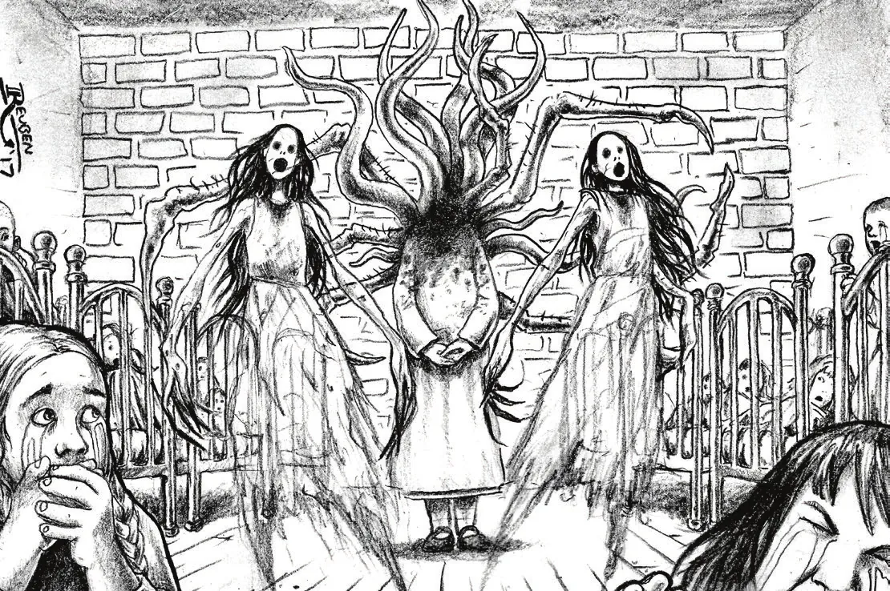

- Если сыщики захотят пойти по этому следу, Хранитель может сделать так, чтобы названный фолиант было получить настолько легко или трудно, насколько требует желаемый темп игры. В конце концов его тёмный текст скажет им, что лучший способ обезвредить точку средоточия — надёжно запечатать её землёй, лучше всего известняком.

**Жуткие явления.** Помимо обычных проявлений призраков, призрачная сила может вызывать необъяснимые внезапные приливы отрицательных чувств. Сыщики (и сироты) могут испытать внезапные необъяснимые приступы печали или отчаяния. Их также могут захлестнуть яркие воспоминания об ужасных событиях из прошлого, особенно о тех, где причиной несчастья были их собственные изъяны. Призрак также может создавать необъяснимые холодные места.

**Погибель и развязка.** Погибель ужаса — плотно запечатать средоточие под камнем и землёй, так чтобы врата лишились всякой связи с человеческим сознанием. Чтобы разрешить любые действия, задействующие эту погибель, пользуйтесь указаниями в статблоке Ужаса сиротской школы. Покрыть стены подвала слоем известняка — малое действие против погибели. Более серьёзная постройка, вроде того чтобы заложить все стены подвала (и пол) толстым слоем штукатурки или цемента, выполнима за день каторжного труда и стоит броска большого действия против погибели твари. Самые радикальные решения, такие как навсегда засыпать весь подвал известняком, займут, вероятно, лишь несколько дней строительных работ, хотя убедить школьный комитет (и колониальное правительство, которому формально принадлежит здание) может оказаться гораздо дольше. Такое решение заслуживает броска значительного действия против погибели ужаса.

Ужас сиротской школы не будет сидеть сложа руки, пока связь с его единственным источником пищи запечатывают. Напротив, он будет бесчинствовать во время работ и даже появится в одной из спален, где заперты девочки, вынуждая спасателей лихорадочно искать ключи.

## Вариант B: Средоточие нужды

При этом варианте призрачная сила, преследующая Школу для девочек-сирот, — странное проявление горя и страданий тех, кто учится в школе, — и даже тех, кому в ней отказали. В школу всегда стремится больше девочек, чем есть мест, и ей приходится…
