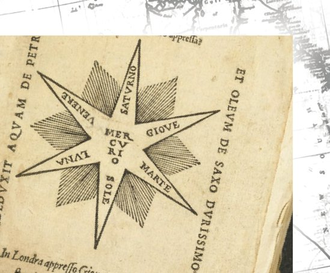

…обычно у края страницы. Обычно это временный эффект, однако если первоначальной маленькой красной книге будет грозить уничтожение, Ужас сиротской школы может превратить любую книгу, найденную в здании школы, в новую вечно кровоточащую книгу. (Это важно, поскольку сущности нужно, чтобы одна такая книга существовала как средоточие её силы.)

**Погибель и развязка.** Погибель этой твари — счастье и смех. Если сыщики смогут принести приюту хоть какую-то передышку, они ослабят силу существа — а может быть, и вовсе его убьют. Чтобы разрешить любые такие попытки, пользуйтесь указаниями в статблоке Ужаса сиротской школы. Попытки облегчить страдания нескольких девочек — малое действие против погибели; устроить так, чтобы все они получили новое постельное бельё или одежду, стоит броска большого действия. Особенно великодушный поступок вроде роскошного рождественского пира для всей школы стоит броска значительного действия.

Если призрак будет окончательно побеждён, он и сопровождающие его призраки рассеются навсегда — вероятно, после эффектного предсмертного представления разнузданной злобы на глазах у как можно большего числа людей.

## Вариант C: Гость капитана Кента

При этом варианте ужас, преследующий школу, — внеземное существо, которое десять (или больше) лет назад призвал на Землю в спящем состоянии временный жилец этого здания. Недавние таинственные события — прямое следствие того, что чуждая тварь наконец «вылупилась» из похожей на яйцо оболочки, в которой с тех пор медленно — невидимо — созревала.

Здание Школы для девочек-сирот прежде было домом капитана Уильяма Кента, деятельного морского капитана с множеством самых разных знакомств. Одним из них был несколько опустившийся морской офицер по имени Клайв Монтроз, который иногда останавливался у Кента, бывая в Сиднее. Монтроз баловался оккультизмом и обладал отрывочным, но опасным знанием кое-каких тайн Мифов Ктулху. Во время одного из визитов к Кенту, в 1799 году, оккультист решил, что время благоприятно для попытки провести один из его замысловатых ритуалов призыва.

После недели приготовлений Монтроз был готов провести ритуал призыва в подвале величественного дома Кента. Много часов ушло на то, чтобы начертить на голом каменном полу замысловатые знаки; ещё больше — на распевание почти непроизносимых песнопений. Целью Монтроза было вступить в связь со скрытой расой высших существ, живущих вне сферы Земли, — этих существ он знал под именем «Пожиратели извне».

Что именно случилось в кульминации этого долгого ритуала, остаётся неизвестным, — но что бы там ни произошло, Клайв Монтроз совершенно обезумел. Кент перевёз его во временную сиднейскую больницу; сам он в «оккультной чепухе» не участвовал, но понял, что что-то неладно, когда яркий столб света пробил пол его кабинета и вышел через крышу в тот самый миг, когда его друг закричал в беспредельном ужасе.

Единственное, что осталось после того, как увезли Монтроза, — странный ком кожистого органического вещества размером с кочан капусты. На ощупь вещь была сухой и, по-видимому, безжизненной. Решив, что это какая-то странная принадлежность (теперь недееспособного) оккультиста, Кент бросил эту вещь в морской сундук и тут же о ней забыл. На самом деле предмет был вовсе не из этого мира, а был зародышевой формой Пожирателя извне, вызванной ритуалом.

Время шло, и капитан Кент продал свой дом, а вместе с ним великое множество вещей — включая морской сундук, в котором лежал зародыш Пожирателя извне. Его чуждое строение созревает не по каким-либо известным человечеству биологическим законам, но каким-то образом тварь в конце концов созрела и «вылупилась». Вышедшая наружу тварь и есть Ужас сиротской школы (на деле — юная стадия жизненного цикла Пожирателя извне). Она живёт, чтобы поглощать энергию, с конечной целью вырасти во взрослого Пожирателя извне.
