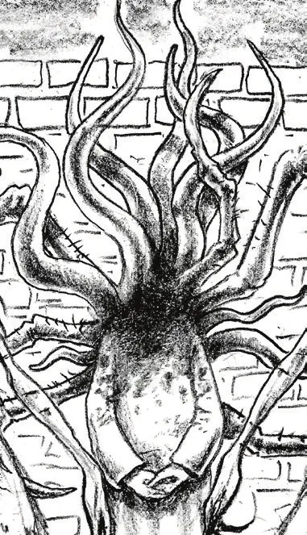

# Характеристики

Ниже приведены игровые характеристики для 7-й редакции «Зова Ктулху».

### Ужас сиротской школы



Это существо явилось из некоего гнусного измерения, питаясь страхом, сожалением и ужасом, которые усиливают его силы. Это призрачный бесформенный ужас, слабо светящийся болезненным зелёным сиянием.

Ужас сиротской школы может принимать разные облики; любимые из них — призрачный ребёнок-сирота (в нём он является детям), призрачная служанка или надзирательница (в нём он является взрослым) и безголовая многощупальцевая тварь с клубящейся тьмой в раздутой середине. В любом облике он издаёт вздохи и невнятное бормотание, которые время от времени прерывает неземной вопль боли и ужаса. Изредка он может выдохнуть свистящий шёпот «подойди» или «дитя моё», но этим его речь и ограничивается. Несмотря на скудную способность общаться, он разумен — и злобен.

```stat
СИЛ —     ВЫН —     ТЕЛ 100   ЛВК 90    ИНТ 75
МОЩ 100   ПЗ: нет
БкУ: нет    Комплекция: —    Скорость: 10    ПМ: 20

АТАКИ
Атак за раунд: 1
У ужаса нет физических атак; нападать он может только особыми силами
(см. ниже).

Броня: нет. Однако Ужасу нельзя повредить ничем, кроме его погибели
(см. «Варианты Мифов»).
Навыки: Знать страхи 100%, Знать детские травмы 100%, Скрытность 60%.
Потеря Рассудка: 1d4/1d10 Рассудка — увидеть Ужас сиротской школы.
```

*Прим. перев.: в оригинале навыки напечатаны «Stealth Know Fears 100%» — первое «Stealth» лишнее (Скрытность указана отдельно, 60%).*

**ОСОБЫЕ СИЛЫ**

**Жатва ребёнка.** Эта сила действует только на детей в приюте (в игре — на всех 16 лет и младше). Ужас терроризирует детей-жертв, показывая им их худшие страхи. Он проецирует их мерцающим изображением на ближайшую поверхность. Любая жертва, проигравшая встречную проверку МОЩ, пока смотрит на эти изображения, погружается в них и больше не может отличить вымысел от яви. Если же ребёнок-цель побеждает, Ужас отступает. Погрузившаяся жертва должна пройти ещё одну проверку МОЩ. Провал повергает жертву в кататонию на 1d10 дней и стоит ей 2d10 пунктов постоянной МОЩ — жизненной энергии, которая тут же добавляется к МОЩ Твари. Выйдя из кататонии, дети мало что помнят, кроме смутных пугающих ощущений.

**Пробудить ребёнка.** Это единственная атака, действующая на взрослых. Сосредоточив свою энергию, Ужас может направить и усилить детские страхи и травмы цели. Даже в счастливом детстве бывают несчастливые минуты, и существо хватается за них, делая их в тысячу раз хуже. Жертвы настоящих детских травм заново переживают эти страшные воспоминания. Цель этой силы проходит встречную проверку своей МОЩ против МОЩ Ужаса. Если взрослый-цель побеждает, ужас отступает. Если цель проигрывает, её захлёстывают чувства, и она беспомощна 1d10 минут. Если Ужасу не помешать, он использует это время, чтобы втянуть оглушённую жертву в своё призрачное протяжённое тело, по сути превращая её в бесплотную форму, которую он может унести туда, где сейчас обитает. Через сутки он извергает её призраком сиротской школы (подробнее — ниже).
