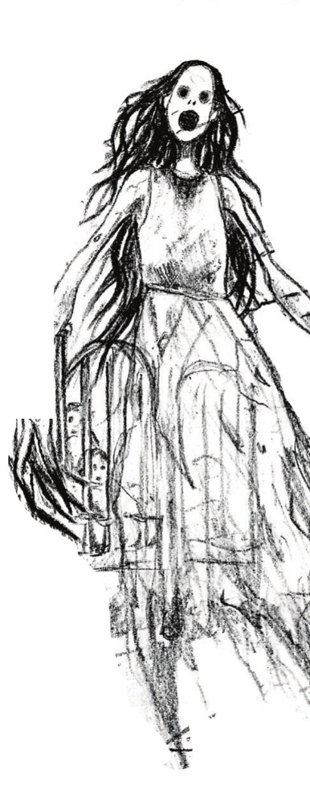
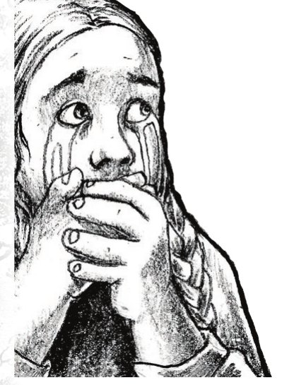

# Что почитать

Есть ещё несколько мест, где Хранитель может найти дополнительные исторические сведения о тяжкой доле девочек в колониях.

- Берил М. Бубач (Beryl M Bubacz), *The Female and Male Orphan Schools in New South Wales, 1801–1850* («Школы для девочек-сирот и мальчиков-сирот в Новом Южном Уэльсе, 1801–1850»), докторская диссертация, Сиднейский университет, 2007. http://hdl.handle.net/2123/2474
- Барри Бриджес (Barry Bridges), *Sydney Orphan Schools 1800–1830* («Сиднейские сиротские школы, 1800–1830»), магистерская диссертация, Сиднейский университет, 1973. https://ses.library.usyd.edu.au/handle/2123/7358
- Джон Ф. Кливерли (John F Cleverly), *The First Generation: School and Society in Early Australia* («Первое поколение: школа и общество в ранней Австралии»), Sydney University Press, 1971.
- Кей Дэниел (Kay Daniel), *Convict Women* («Каторжницы»), Allen & Unwin, 1998.
- Кэти Данн (Cathy Dunn), «Sydney Female Orphan School 1801–1818» («Сиднейская школа для девочек-сирот, 1801–1818»), Australian History Research, http://www.australianhistoryresearch.info/sydney-female-orphan-school-1801-1818/

---

*Понравилось прочитанное, но у вас ещё нет основной книги «Convicts & Cthulhu»? Загляните на RPGNow или DrivethruRPG и возьмите себе экземпляр — в PDF или в мягкой обложке (печать по требованию). Оба варианта доступны по модели «Плати сколько хочешь»: вы платите только себестоимость экземпляра (0 долларов за PDF или около 4 долларов США за книгу в мягкой обложке) и сколько угодно сверху — как благодарность Cthulhu Reborn.*
