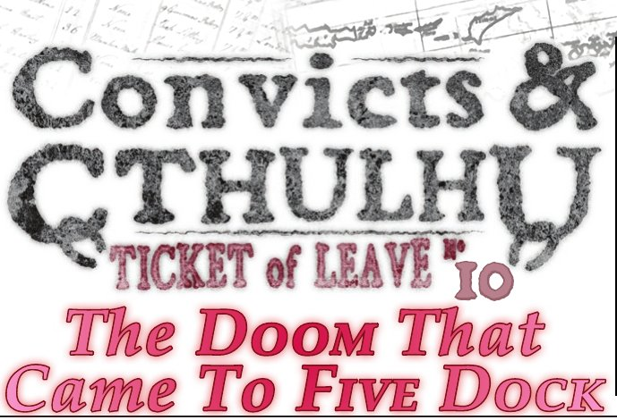
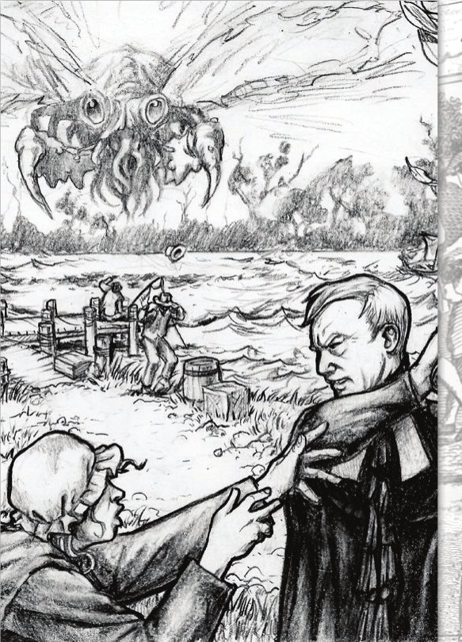

ГИБЕЛЬ, ПРИШЕДШАЯ В ФАЙВ-ДОК

Convicts &amp; Cthulhu — Отпускной билет № 10

*Вверху страницы — логотип «Convicts & Cthulhu — Ticket of Leave № 10» и заглавие «The Doom That Came To Five Dock» («Гибель, пришедшая в Файв-Док»).*

> «Отпускные билеты» (Tickets-of-Leave) — небольшие самостоятельные дополнения к сеттингу «Convicts & Cthulhu» для лавкрафтовских ролевых игр в ранних каторжных колониях Австралии. В каждом — подборка игровых элементов: их можно использовать все вместе как набросок мини-сценария или по отдельности — как детали, которые обогатят сценарий вашего собственного сочинения.

> **Выходные данные**
>
> «Отпускной билет» № 10 написал Дин Энгельхардт (Dean Engelhardt) при участии Джеффа Гиллана (Geoff Gillan); оригинальные иллюстрации — Рубен Додд (Reuben Dodd). © 2018. Издаёт Cthulhu Reborn Publishing (www.cthulhureborn.com).
>
> Сеттинг «Convicts & Cthulhu» издаёт Cthulhu Reborn Publishing; он доступен на RPGNow и DrivethruRPG по модели «Плати сколько хочешь» (Pay-What-You-Want).
>
> Этот PDF использует товарные знаки и/или авторские права Chaosium Inc/Moon Design Publications LLC в рамках правил Chaosium для фанатских материалов (Fan Material Policy). Нам прямо запрещено брать с вас плату за использование этого материала или доступ к нему. Этот PDF не издан, не одобрен и не утверждён особо компанией Chaosium Inc. Подробнее о продукции Chaosium Inc — на www.chaosium.com.
>
> Лицензия Creative Commons BY-NC-SA.

# Вступление

Когда в 1788 году европейцы впервые поселились на Австралийском континенте, больше всего в новом доме их смущала полная непривычность — чуждость — здешней природы. Всё, от пород деревьев до видов животных, обитавших в Новом Южном Уэльсе, было новым и неизведанным. Горстку людей науки это множество новых видов приводило в изумление и восторг. Большинство же прочих европейцев странное окружение скорее тревожило, чем радовало: в конце концов, кто по-настоящему знал, какие звери могут таиться сразу за краем обжитых поселений и только и ждать, когда одинокий путник забредёт не туда? Эта естественная тревога усиливалась среди множества суеверных мужчин и женщин колоний (каторжников, стражников и свободных поселенцев без разбора). Рассказы таких людей о странных и неведомых животных, встреченных в глухих местах, нередко разрастались в жуткие истории о фантастических чудищах и страшных опасностях.

Конечно, в мире, куда наведываются силы Мифов Ктулху, не все эти ужасающие рассказы непременно преувеличены.

Этот «Отпускной билет» обыгрывает суеверную боязливость европейских колонистов и потрясающую удалённость некоторых их поселений и предлагает сценарий, в котором сыщикам предстоит расследовать, казалось бы, невозможную историю масштабного разрушения без всякой естественной причины. Но хотя ужасная сила, сровнявшая с землёй постройки и убившая дюжину человек, может быть родом из-за грани, мотивы, приведшие к этому кошмарному событию, — не окажутся ли они слишком уж человеческими?..

> *«Не колеблясь скажу, что во всём мире нет страны хуже той, что мы до сих пор здесь видели. Всё, что прилегает к нам, так бесплодно и неприветливо, что поистине можно сказать: здесь Природа вывернута наизнанку».*
>
> — Майор Роберт Росс (офицер морской пехоты и вице-губернатор при Артуре Филлипе, 1788)
