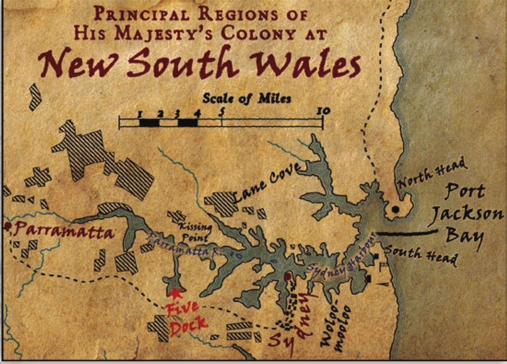

*Карта: «Главные области колонии Его Величества в Новом Южном Уэльсе», шкала в милях (Scale of Miles, 0–10 миль = 0–16 км). Подписи на карте: Parramatta — Парраматта; Kissing Point — Киссинг-Пойнт; Parramatta R. — река Парраматта; Lane Cove — Лейн-Ков; North Head — мыс Норт-Хед; Port Jackson Bay — залив Порт-Джексон; South Head — мыс Саут-Хед; Sydney Harbour — Сиднейская гавань; Five Dock — Файв-Док (красная звезда); Sydney — Сидней; Woloomooloo — Вулумулу (так на карте).*

### Визг гибели

Окончательная гибель, однако, пришла, когда Матриарх роёв издала свой ужасающий звуковой удар — хор визга и свиста такой силы, что прочные сваи пристани разлетелись в щепки, а многочисленные хлипкие склады сровнялись с землёй. Этот жуткий зов был так могуч, что у нескольких уцелевших паромщиков от давления звука лопнули глаза.

Когда короткое, но страшное нападение кончилось, от Файв-Дока не осталось ничего — все до единой постройки были сровнены с землёй. Повсюду лежали тела. [И хотя по всем признакам казалось, что каждый мужчина и каждая женщина на месте погибли, очень многие на деле остались живы, но парализованы жалом Матриарха. В этих живых носителей Великая Древняя ввела свои яйца.]

Прошли часы, прежде чем кто-нибудь заметил разорение. Паром, шедший в Сидней, проходил мимо и пристал к южному берегу реки — его команда пришла в ужас от открывшейся картины опустошения. Сначала казалось, что выживших нет и что над некоторыми телами грубо надругались — прежде всего над телом церковника. Но в конце концов команда наткнулась на одного выжившего — матроса по имени Макграт, ослепшего во время нападения.

Забрав незрячего, команда парома продолжила путь в Сидней. По прибытии моряки сообщили колониальным властям обо всём, что видели в Файв-Доке. Весть об их страшной находке — вскоре приукрашенная и преувеличенная — начала расходиться.

### Владельцы фермы Файв-Док

Смутные рассказы о разрушениях в Файв-Доке встревожили всех, но больше всего — владельцев фермы, которая граничит с этим отдалённым местом. Ферма Файв-Док — общая собственность двух уважаемых медиков колонии, хирургов Джона Харриса и Мэтью Туми. Оба тут же вызвались лечить раненого Макграта и выведать у него побольше о его отрывочной истории. Услышанное их сильно встревожило. Особенно обеспокоили подробности нападения на Файв-Док и немыслимо огромное насекомое, его учинившее, младшего из хирургов — Туми. Помимо успехов на врачебном поприще, он ещё и член оккультного общества, кое-что знающего о Мифах Ктулху, — и ему дикий рассказ о великом уродливом ужасе кажется слишком уж правдоподобным.

Обоих хирургов рассказ Макграта — не говоря уже о нескольких подтверждающих его рассказах команд паромов, прибывших позже в тот же день, — встревожил настолько, что они предложили немедленно провести расследование. Понимая, что отправляться в путь одним опасно и неизвестно насколько, влиятельный Харрис сумел выхлопотать у губернатора небольшой отряд для охраны в дороге.

## Как вовлечь сыщиков

Сыщики оказываются втянуты в сценарий, когда их прикомандировывают к спешно собранной экспедиции, которая должна проверить слухи о Файв-Доке. Есть две главные причины, по которым они могут туда попасть.

Во-первых, к сыщикам высокого положения, уже прославившимся расследованием странных событий в колонии, Харрис может обратиться напрямую — пригласить их в отряд консультантами. Так может случиться и в том случае, если эти люди прежде помогали Харрису или одному из многих учреждений, с которыми он связан (например, Сиднейской больнице или Школе для девочек-сирот, описанной в «Отпускном билете» № 9).

Во-вторых, сыщики могут попасть в экспедицию по приказу колониального секретаря. Экспедиции Харриса и Туми выделили каторжников и солдат Корпуса Нового Южного Уэльса — рабочую силу, чтобы нести поклажу и охранять руководителей экспедиции, если в Файв-Доке всё ещё опасно. Этот отряд может состоять из сыщиков, при необходимости дополненных персонажами Хранителя.
