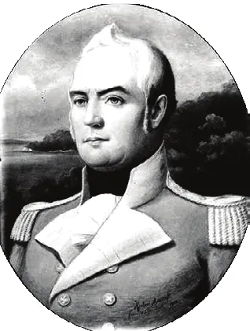

## Истинная природа угрозы

Мотивы, которые в конечном счёте привели к опустошению Файв-Дока силами Мифов, зависят от того, какой вариант выбрал Хранитель (см. «Варианты Мифов» на с. 12).

- **Вариант A — Многострадальные оковы.** В этой версии призыв Матриарха роёв был порывистым и глупым поступком одной из каторжниц, бывших в Файв-Доке, — Элайзы Петти. Элайза лишь слегка владеет колдовством Мифов, но этого хватает, чтобы быть опасной. Когда ей пригрозили жестоким телесным наказанием за то, что она отвергла похотливые домогательства «надзирателя» группы (мерзкого преподобного Джорджа Фенби), она сорвалась и вызвала ужас из-за грани. Окаменев от ужаса перед содеянным, каторжница бежала с места ещё до того, как началась самая страшная бойня.
- **Вариант B — Чернейший шантаж.** В этой версии призыв Матриарха роёв был холодным и расчётливым поступком каторжницы Элайзы Петти — показом силы, подкрепляющим её шантаж младшего хирурга (и культиста по совместительству) Мэтью Туми. Петти уже несколько недель анонимно угрожает Туми, но безрезультатно; она решила поднять ставки и доказать упрямому молодому человеку, что действительно может обрушить беду на него и на всё, чем он владеет, если он откажется выполнить её требования. К несчастью, вызванная тварь оказалась куда могущественнее, чем могла вообразить колдунья-любительница, и теперь та сама с трудом пытается пережить последствия своего поступка.
- **Вариант C — Яйцо, что не проклюнется.** В этой версии явление Матриарха роёв стало следствием того, что Великая Древняя наконец выследила одного из (многих) культистов-людей, злоупотребляющих её потомством ради личной силы. В этом варианте двое главных персонажей Хранителя — младший хирург Мэтью Туми и покойный священник Джордж Фенби — состоят в безвестном культе, известном как Рыцари Асклепия (см. врезку рядом). Фенби…

> **Доктор Джон Харрис, хирург Корпуса Нового Южного Уэльса, 1754–1838**
>
> 
>
> Джон Харрис родился в Лондондерри (Ирландия). Учился хирургии в Эдинбурге и служил корабельным хирургом в индийских водах. В 1789 году перевёлся в Корпус Нового Южного Уэльса и в 1790 году прибыл в Сидней, где служил сначала помощником хирурга, затем хирургом. Его поставили в Парраматту, где Харрис принял земельный надел в 40 гектаров и занялся побочным делом — фермерством, заведя несколько ферм вокруг Парраматты и Сиднея. Он занимал в колонии множество важных должностей: в 1800 году стал магистратом и в том же году возглавил полицию, в 1801 году был назначен морским офицером в Сиднее, а в 1803 году — заместителем военного прокурора. Он был и исследователем — в 1801 году нанёс на карту реку Хантер. Состоял также в комитетах сиротской школы и тюрьмы.
>
> Губернатор Кинг доверял Харрису, но служба ссорила его с сослуживцами-офицерами, особенно с монополистами. Он навлёк на себя гнев врагов Кинга и в 1802 году был отстранён от гражданских должностей по обвинению в «поведении, недостойном джентльмена» (по сути, за то, что передал Кингу, что некоторые офицеры говорили о губернаторе). В 1804 году Харриса восстановили. У него был знаменитый дом в Ультимо в Сиднее. В 1807 году Блай снял Харриса с гражданских должностей и тем самым навлёк на себя его вражду. С тех пор фермер-хирург был одним из главных противников Блая и примкнул к Корпусу Нового Южного Уэльса в Ромовом бунте. В 1808 году мятежная администрация вернула его в магистраты, но в том же году он поссорился с Джоном Макартуром и на время (снова) лишился места магистрата. В 1809 году он отплыл в Англию, где давал показания на военном суде над Джонстоном по делу о Ромовом бунте. В 1814 году Харрис вернулся свободным поселенцем вместе с женой Элайзой. До конца жизни он оставался в колонии, процветал как фермер и поддерживал многие общественные начинания, в том числе основание Банка Нового Южного Уэльса. Умер в 1838 году.
