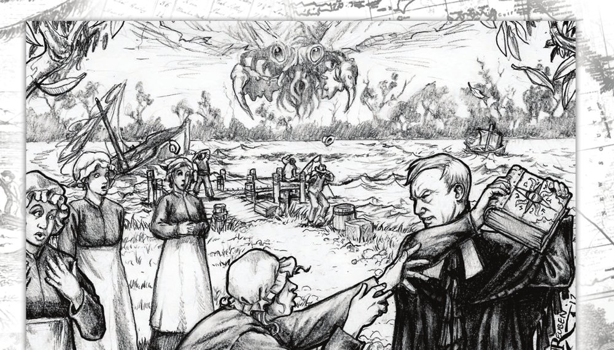

### Расспросы команды парома, спасшей Макграта

*(или любой другой, что проходила мимо Файв-Дока)*

- Разыскать кого-нибудь из команды, спасшей Макграта, не удастся: все они уже вернулись к перевозке грузов и пассажиров вверх по Сиднейской гавани в Парраматту.
- Другие команды подтверждают основную историю о разрушенных постройках и пристанях, хотя ни одна не согласна с рассказами о «поле боя», усеянном трупами.
    - Одному паромщику, кажется, привиделся труп, висевший на сломанном суку большого эвкалипта.

### Расспросы о группе «каторжных девушек», ехавших в Парраматту

В рассказе Макграта особо упоминается большая группа каторжниц, бывших в Файв-Доке и, судя по всему, оказавшихся в центре нападений летающей твари. Сыщики без труда проверят подробности об этих женщинах:

- В тот день группа женщин ехала из Сиднея, чтобы приступить к работе на новой Женской фабрике в Парраматте, — должно быть, это та самая группа из рассказа паромщика.
- Группу сопровождал тюремный капеллан, преподобный Джордж Фенби.
- В эту группу каторжных девушек входили «известные смутьянки» — особенно отчаянные, которые и прежде доставляли немало хлопот.
    - Самой непокорной в группе была молодая «чертовка» по имени Элайза Петти.
- Из-за того, что в группе были такие смутьянки, её должен был сопровождать вооружённый конвоир из Корпуса Нового Южного Уэльса, но он не успел к отправлению.
    - [ТРУДНО] (На самом деле солдат Корпуса так мучился похмельем, что проснулся лишь через много часов после того, как паром ушёл от Серкьюлар-Ки.)

### Расспросы об Элайзе Петти

- Элайза всегда попадала в беды — даже за те несколько лет, что провела в Школе для девочек-сирот.
- [ТРУДНО] Некоторые другие каторжницы считают Элайзу «ведьмой» за особые «фокусы», которые она порой показывает, — например, огонь, сам собой вспыхивающий у неё на ладони.
