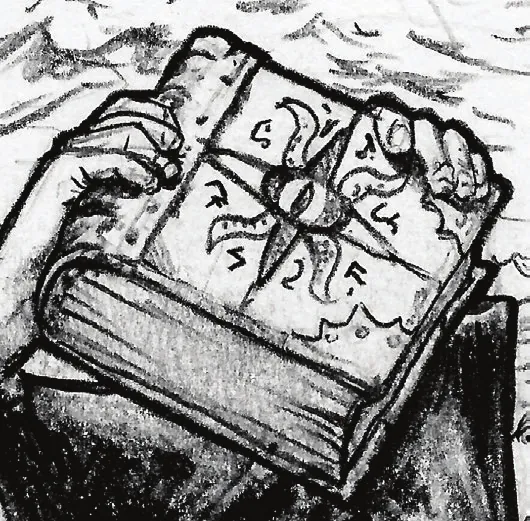

…не выказал ни малейшего желания принимать хоть одну из угроз всерьёз. Решив, что нужно доказать, что её угрозы не пустые, она написала последнее письмо с намёком на то, что может обрушить разрушение на имущество Туми… а затем принялась призывать мерзкого Матриарха роёв на владения Туми в Файв-Доке (с помощью заклинания из собственной книги Мифов доктора). Однако истинный ужас бога-насекомого превзошёл всё, чего она ожидала, и вскоре шантажистка сама бежала с места учинённого ею разрушения.

**Дополнительные улики:**

- Обыск вещей Туми обнаружит пачку писем с угрозами, присланных Петти.
- Обыск дома Туми может обнаружить его дневник или другие бумаги, где упоминаются Рыцари Асклепия; и то и другое укажет на его членство в этом ордене.
- Наблюдая за Туми во время экспедиции в Файв-Док, можно заметить, что он странно нервничает и, похоже, преследует какую-то скрытую цель.

**Как расправиться с ужасом.** Помимо обычных способов, описанных выше, сыщики могут одолеть Великую Древнюю и её отродье, убедив Элайзу Петти отказаться от злобного замысла шантажировать Туми. Призыв питала главным образом ненависть в её сердце, и если эту чёрную яму ненависти удастся каким-то образом обезвредить, бо́льшая часть того, что поддерживает связь Матриарха с нашей реальностью, ослабнет.

## Вариант C: Яйцо, что не проклюнется

В этом варианте «призыв» Зстилжемгни в Файв-Доке был не намеренным поступком, а своего рода несчастным случаем. Доктор Мэтью Туми — не только весьма одарённый хирург, но и член безвестного культа, известного как Рыцари Асклепия. Этот орден черпает силу в умении добывать частицы существ и богов Мифов и буквально вживлять их в тела добровольных людей-носителей. Излюбленный предмет этой необычной практики — незрелые иномерные яйца Матриарха роёв. Всякий раз, находя кладку этих редчайших предметов, группа собирает их и консервирует для последующего вживления. Недавно Туми ставил хирургические ритуальные опыты на добровольце — распутном священнике преподобном Джордже Фенби. Но, как всегда при операциях Рыцарей, Туми очень тщательно творил все нужные заклинания, чтобы силы Мифов Ктулху никогда не узнали о таком надругательстве над их плотью.

В случае Фенби эта защита не сработала. «Наказывая» одну из юных каторжниц, отданных ему на попечение, мерзкий капеллан имел несчастье соприкоснуться со Знаком Старших богов. К беде, это соприкосновение ненадолго прервало заклинания, скрывавшие его вживлённую тайну… и из своего дома в каком-то непостижимом ином измерении Матриарх его заметила. Подгоняемая яростью, Великая Древняя явилась в Файв-Док и обрушила страшное возмездие на Фенби и на всех, кто был рядом.

**Дополнительные улики:**

- Расспросы об Элайзе Петти принесут рассказ о старом золотом кольце, которым она очень дорожит: мать сказала ей, что оно защитит её от всех демонов ада.
- Каторжники-работники Сиднейской больницы заметили, что Мэтью Туми часто задерживается допоздна, чтобы «упражняться в своём искусстве» до глубокой ночи; кто-нибудь из них, возможно, даже застал его среди ночи за операцией при свете фонаря.
- Преподобный Джордж Фенби в последнее время хвастается, что у него «особая жизненная сила» благодаря особому лечению, которое он получает…
