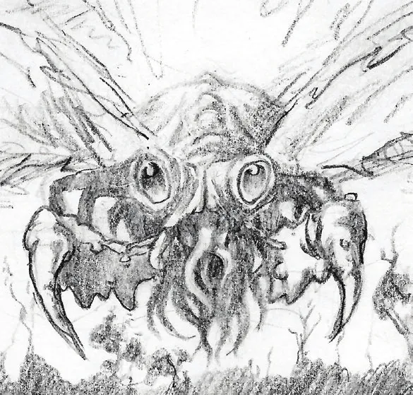

```stat
СИЛ 125   ВЫН 335   ТЕЛ 185   ЛВК 105   ИНТ 90
МОЩ 150   ПЗ 52     ПМ 30
БкУ: +3d6    Комплекция: 4    Скорость: 15 / 21 в полёте

АТАКИ
Атак за раунд: 1
Укус            80% (40/16), урон 1d6 + БкУ
Жало            80% (40/16), урон 1d6+2 + яд
Звуковой визг   60% (30/12), урон см. ниже. Поражает конусообразную
                область [стоит 15 ПМ]
Ввести яйца     100% (50/20), см. ниже (жертва должна быть уже
                парализована или беспомощна)
Уклонение       70% (35/14)

Броня: 15 очков — твёрдый хитиновый панцирь.
Заклинания: по желанию Хранителя.
Потеря Рассудка: 1d6/1d20 Рассудка — увидеть гигантское тело насекомого,
облик Зстилжемгни.
```

**ОСОБЫЕ СИЛЫ**

**Ядовитое жало.** Любой человек, ужаленный зловещим жалом бога-насекомого, автоматически получает дозу чуждого яда, который наносит ещё 3d10 ПЗ урона, растянутых на 1d6 раундов. Если жертва преуспеет в чрезвычайной проверке ВЫН, урон уменьшается вдвое. Даже пережившие этот урон всё равно страдают от внеземного яда: они парализованы на 24 часа минус 1 час за каждые 5 очков ВЫН. Медицинская помощь парализованному (успешная проверка Первой помощи или Медицины) тоже снимает паралич.

**Звуковой визг.** Бог-насекомое может быстро тереть задние ноги друг о друга, издавая могучий и безумно громкий визг. Эта атака поражает конусообразный объём, который начинается у тела Матриарха и тянется по прямой на 20 метров; в самой дальней точке конус имеет 10 метров в поперечнике. Для этого нужно пожертвовать 15 пунктами магии. Бросок атаки определяет, направлен ли конус туда, куда задумала Матриарх. «Промах» означает, что звуковая атака всё равно происходит, но поражает область, смещённую от цели на 1d10 метров в сторону по выбору Хранителя. Все, кто оказался в конусе, получают урон по таблице ниже:

| Расстояние от источника | Урон |
|---|---|
| 0–5 м | 2d10 ПЗ; жертва должна пройти трудную проверку ВЫН, иначе от звукового давления у неё лопаются глаза или навсегда рвутся барабанные перепонки. |
| 6–10 м | 1d10+5 ПЗ; жертвы должны пройти проверку ВЫН, иначе получают перелом или похожую травму от звукового удара. |
| 11–20 м | 1d6 ПЗ |

**Ввести яйца.** Если жертва полностью парализована или беспомощна, бог-насекомое может пожертвовать раундом атак, чтобы вместо этого ввести ей 1d6 яиц своего потомства (см. ниже). Яйца вводятся на несколько сантиметров в плоть жертвы; эта атака наносит жертве всего 1 ПЗ урона, но он или она будет вынашивать яйца твари. Если их как-то не извлечь, через 1d6 дней они вылупятся и прогрызут себе путь из плоти жертвы — неприятный процесс, который наносит носителю 1d3 ПЗ урона за каждый новорождённый ужас-насекомое. Однако до этого вживлённые яйца даже дают носителю выгоду — дополнительную МОЩ и пункты магии. За каждое яйцо в теле носителя он получает +30 очков МОЩ и +6 пунктов магии (пока яйцо не вылупится).
