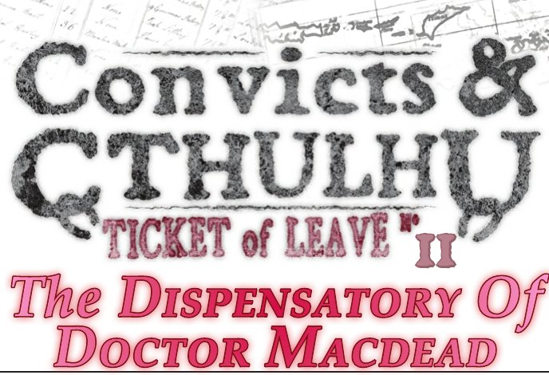
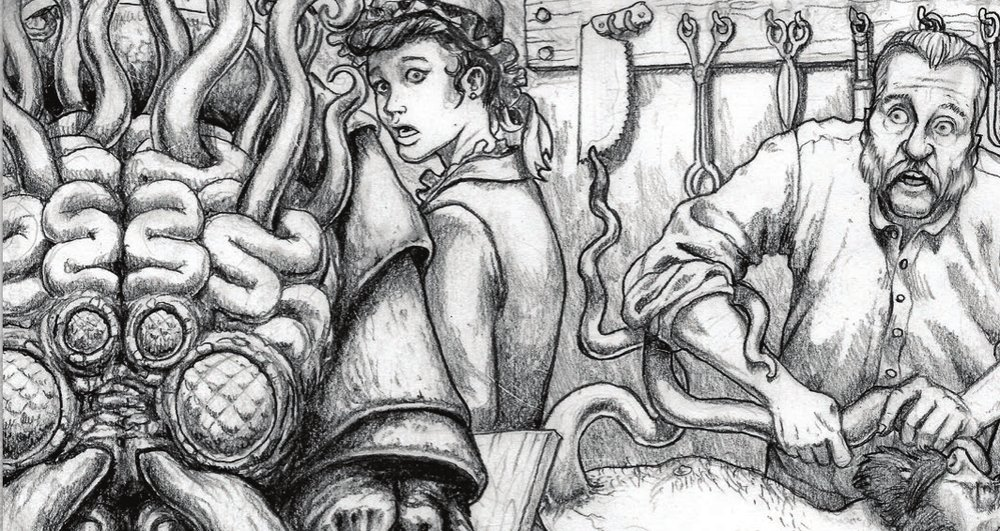

ФАРМАКОПЕЯ ДОКТОРА МАКДЕДА

Convicts &amp; Cthulhu — Отпускной билет № 11

*Вверху страницы — логотип «Convicts & Cthulhu — Ticket of Leave № 11» и заглавие «The Dispensatory of Doctor Macdead» («Фармакопея доктора Макдеда») на фоне старинных рукописей и гравюр.*

> «Отпускные билеты» (Tickets-of-Leave) — небольшие самостоятельные дополнения к сеттингу «Convicts & Cthulhu» для лавкрафтовских ролевых игр в ранних каторжных колониях Австралии. В каждом — подборка игровых элементов: их можно использовать все вместе как набросок мини-сценария или по отдельности — как детали, которые обогатят сценарий вашего собственного сочинения.

> **Выходные данные**
>
> «Отпускной билет» № 11 написали Джефф Гиллан (Geoff Gillan) и Дин Энгельхардт (Dean Engelhardt); оригинальные иллюстрации — Рубен Додд (Reuben Dodd). © 2018. PDF издаёт Cthulhu Reborn Publishing (www.cthulhureborn.com).
>
> Сеттинг «Convicts & Cthulhu» издаёт Cthulhu Reborn Publishing; он доступен на RPGNow и DrivethruRPG по модели «Плати сколько хочешь» (Pay-What-You-Want).
>
> В этом PDF используются товарные знаки и/или авторские права Chaosium Inc./Moon Design Publications LLC — по правилам Chaosium для фанатских материалов (Fan Material Policy). Нам прямо запрещено брать плату за использование этого материала или доступ к нему. Этот PDF не издан, не одобрен и не утверждён Chaosium Inc. Подробнее о продукции Chaosium Inc. — на www.chaosium.com.
>
> Лицензия Creative Commons BY-NC-SA.

# Вступление

Сыщики лавкрафтовских ролевых игр сталкиваются с медициной едва ли не с пугающей частотой. Нужна ли им срочная помощь после стычки с отъявленными негодяями или они раскрывают гнусные злодеяния очередного подражателя Герберта Уэста — сыщики то и дело оказываются в обществе врачей. В каторжных колониях ранней Австралии лечение было пугающе примитивным даже по меркам того времени — и всё же для большинства персонажей кампании «Convicts & Cthulhu» другого выбора нет.

Этот «Отпускной билет» даёт обзор медицинской практики в колонии Новый Южный Уэльс: описывает плачевное положение с медицинскими припасами из Англии, а также исторических хирургов каторжного поселения. Кроме того, в нём есть мрачная и жуткая история на медицинскую тему, действие которой происходит в больнице Парраматты и вокруг неё.

Хотя некоторые медики колонии начинали признавать действенность традиционной медицины аборигенов («медицины буша») и важность знания лечебных и целебных свойств растений, которые были под рукой в Новом Южном Уэльсе, большинство всё ещё полагались на европейские методы. Это значило — полагаться на снадобья из европейских ингредиентов, часто приготовленные в Англии, доставленные в колонию морем и применяемые на европейский лад. Медики также во многом опирались на европейские медицинские книги, которые в колониях были редкостью.

