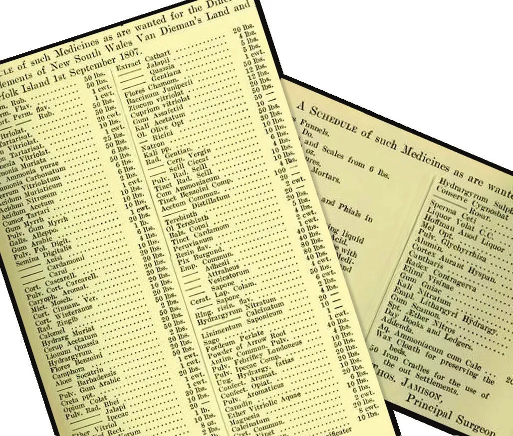

> ## Лекарства колониальной эпохи и их применение
> ### (по перечню лекарств)
>
> Рядом показан перечень медицинских припасов, запрошенных для колонии в 1807 году. В нём много разных веществ, но они делятся на две главные группы — «простые средства» (Simples) и средства, созданные «механической операцией» (Mechanical Operation). К первым относятся травы, корни, листья и ростки, обычно европейского происхождения. Вторые — лекарства, изготовленные соединением или разделением веществ; в итоге получаются соединения или другие вещества, которых нет в природе.
>
> Многие вещества из списка, очевидно, готовили в Англии и присылали готовыми смесями. То, что тот же самый список был нужен и три года спустя, говорит о том, что в колонии не было серьёзных химических знаний, позволявших изготовлять эти средства на месте.
>
> Несколько примеров того, как применяли эти вещества:
>
> - **Кислоты** — всё, что помечено в перечне словом «acidum». Эти лекарства используют прежде всего как слабительные, но также и для другого лечения. Например, пары Acidum Muratium (соляной кислоты) считаются действенными против заразы (хотя обращаться с ними надо осторожно: известно, что порой они смертельны).
> - **Железо** — всё, что помечено в перечне словом «ferrum». Это лекарства с высоким содержанием железа; ими лечат геморрой, понос, рвоту и лихорадки.
> - **Соли** — всё, что помечено в перечне словом «kali». Эта группа лекарств — семейство солей, из которых можно делать железистую воду (chalybeate) — разновидность минеральной воды, которая, как считается, укрепляет здоровье.

*Под врезкой — скан двух листов старинного печатного перечня, наложенных друг на друга и обрезанных краями страницы. Перевод того, что в нём читается:*

> **Перечень лекарств, необходимых для разных поселений Нового Южного Уэльса, Земли Ван-Димена и острова Норфолк, 1 сентября 1807 года**
>
> Количества указаны в фунтах (lbs.), унциях (oz.) и хандредвейтах (cwt. — около 51 кг); по скану их не всегда можно сопоставить с названиями, поэтому ниже — только названия, как напечатано (латынь аптекарей), с пояснением.
>
> *Первая колонка (видна частично):* … Rub., … Flav., … Perm. flav., … Perm. Rub.; … Vitriolat., … Tartarisat. (купоросные и винные соли); Magnesia Vitriolat. (английская соль); Ammonia Muriata, Ammonia purae, Ammonia Carbonatum (нашатырь, нашатырный спирт, углекислый аммоний); Ferrum Vitriolatum (железный купорос); Acidum Muriaticum, Acidum Nitrosum, Acidum Acetum (соляная, азотная кислота, уксус); Cremor Tartari (винный камень); Gum Myrrh, Pulv. Gum Myrrh (мирра, порошок мирры); Galls Alleppo (алеппские чернильные орешки); Gum Arabic (гуммиарабик); Pulv. Fol. Digit., Semina Digitalis (порошок листьев и семена наперстянки); — Anisi, — Cardamomi, — Carui (семена аниса, кардамона, тмина); Cort. Cascarell., Pulv. Cort. Cascarell. (кора каскариллы и её порошок); Caryoph. Aromat. (гвоздика); Nuc. Mosch. (мускатный орех); Cort. Cinnam. Ver. (кора настоящей корицы); Cort. Winteranus (винтерова кора); Rad. Zingib. (корень имбиря); Calomel (каломель); Hydrarg. Muriat. (сулема); Cerus. Acetatum (уксуснокислый свинец); Lignum Quassia (квассиевое дерево); Hydrargyrum (ртуть); Flores Benzoini (бензойные цветы); Camphora (камфора); Aloes Socatrin, — Barbadensis (сокотринское и барбадосское алоэ); Pulv. Gum Arabic (порошок гуммиарабика); Creta ppt. (осаждённый мел); Opium Colat. (очищенный опий); Pulv. Rad. Rhei, — Jalapi, — Ipecac. (порошок корня ревеня, ялапы, ипекакуаны); Ether Vitriol. Rect. (очищенный серный эфир)…
>
> *Вторая колонка:* Extract Cathart., — Jalapii, — Quassia, — Gentiana (экстракты слабительный, ялапы, квассии, горечавки); Flores Chamom. (цветы ромашки); Baccinum Juniperii (ягоды можжевельника); Zincum vitriolat. (цинковый купорос); Cuprum vitriolat. (медный купорос); Gum Assafetid. (асафетида); Kali Acetatum (уксуснокислый калий); Ol. Olive Opt., — Ricini (лучшее оливковое и касторовое масло); Natron (сода); Kali pp. (осаждённый поташ); Rad. Gentian., — Serp. Vergin., — Scill. Siccat. (корень горечавки, змеевика виргинского, сушёный лук морской); Pulv. Rad. Scill. (порошок морского лука); Tinct. Rad. Scill. (настойка морского лука); Gum Ammoniacum (аммониак); Tinct. Benzoini Comp. (сложная бензойная настойка); Acetum Commun., — Distillatum (уксус простой и перегнанный); Terebinth, Ol. Terebinth (скипидар, скипидарное масло); Bals. Copai (копайский бальзам); Tinct. Cardamom (настойка кардамона); — Peruvianum (перуанский бальзам); Resin flav. (жёлтая смола); Pix Burgund. (бургундская смола); Emp. Commun., — Adhesif., — Attraheus, — Vesicatorum, — Sapone (пластыри простой, липкий, вытягивающий, нарывной, мыльный); Cerat. Lap. Calam. (цератная мазь с каламином); — Sapone (мыльный церат); Ung. resin. flav. (мазь из жёлтой смолы); Hydrargyrum Nitratum, — Calcinatum (азотнокислая и прокалённая ртуть); Linimentum Saponicum (мыльный линимент); Sago (саго); Hordeum Perlate (перловая крупа); Powder of Arrow Root (порошок аррорута); Antim. Commun. Pulv. (порошок сурьмы); Pulv. Febrifug. Londonens (лондонский жаропонижающий порошок); Pulv. Ipecac. Comp. (сложный порошок ипекакуаны); Ung. Hydrargy. fortius (крепкая ртутная мазь); Confect. Aromat., Confect. Opiat. (ароматическая и опиатная кашка); Pulv. Aromaticus (ароматический порошок); Canadin… (?); Ether Vitriolic Aquae (сернистоэфирная вода); Magnesia, — Calcinatum (магнезия, жжёная магнезия); … Commun. …
>
> *Второй лист, «Перечень лекарств, необходимых…» (виден частично):* … воронки; … и весы от 6 фунтов; … мерки; … ступки; … и склянки; … кислота … (остальное скрыто). Hydrargyrum Sulph. (сернистая ртуть); Conserve Cynosbat., — Rosar. (шиповниковое и розовое варенье); Sperma Ceti (спермацет); Liquor Volat. C.C. (летучая жидкость оленьего рога); Hoffman Anod. Liquor (гофманские капли); Mel Opt. (лучший мёд); Pulv. Glychyrrhiza (порошок солодки); Alumin. (квасцы); Cortex Aurant. Hyspan. (корка испанского апельсина); Cantharis (шпанская мушка); Radex Contrayerva (корень контраервы); Elimi (элеми); Gum Guiac (гваяковая смола); Kali Nitratum (селитра); Empl. Lithargyri Hydrargy. (свинцово-ртутный пластырь); Gum Scamon. (скаммония); Spt. Æther Nitros. (сладкий азотный спирт); Day Books and Ledgers (журналы и счётные книги). *Добавление:* Aq. Ammoniacum cum Calc. (известковый нашатырный спирт); Wax Cloath for preserving the beds (вощёная ткань для сбережения постелей); 50 Iron Cradles for the use of the out Settlements (50 железных люлек для дальних поселений).
>
> Подпись: **Томас Джеймисон, главный хирург** (Thos. Jamison, Principal Surgeon).

*Прим. перев.: перечень — скан исторического документа, обрезанный краями страницы и местами нечитаемый; названия даны как напечатано, пояснения к ним — переводчика, многоточия означают скрытое или нечитаемое.*
