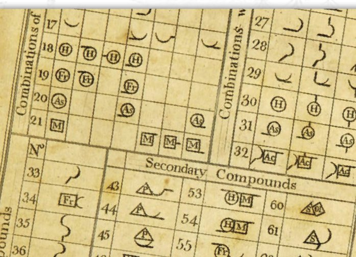

## Недостойный сброд

Все губернаторы и хирурги на протяжении эпохи «Convicts & Cthulhu» раздражены кажущимся равнодушием и, как следствие, бездействием Колониального ведомства во всём, что касается здоровья колонии. У губернатора Уильяма Блая за время его правления складываются особенно враждебные отношения с медиками (впрочем, это едва ли удивительно: он, похоже, умудряется враждовать примерно с половиной колонии). Блай считает, что врачей слишком мало, и раздражён тем, что те, кому поручено заботиться о здоровье колонии, по-видимому, больше заинтересованы в торговле и наживе, чем в лечении.

Сами врачи тоже раздражены — особенно нехваткой припасов и другой поддержки со стороны губернаторов и Колониального ведомства в Лондоне. Вдобавок колониальные хирурги обязаны бесплатно лечить больных поселенцев и прочих, кто не стоит на казённом довольствии, — это положение исправят лишь много позже эпохи «C&C».

## Колониальные хирурги

Ниже даны краткие описания нескольких важнейших исторических лиц, связанных с лечением в ранней колонии Новый Южный Уэльс. Кроме них, дополнительные сведения о хирурге Корпуса Нового Южного Уэльса докторе Джоне Харрисе можно найти в «Отпускном билете» № 10 (вместе с приключением, где участвуют он и вымышленный младший помощник хирурга).

### Джон Уайт
#### (колониальный хирург Нового Южного Уэльса: 1788—1794)

Уайт родился в 1757 году и с 1778 года служил помощником хирурга во флоте. В 1781 году он стал хирургом, а в Ботани-Бей его рекомендовал его капитан, сэр Эндрю Снейп Хаммонд, когда Уайт служил корабельным хирургом на «Иррезистибле» (HMS *Irresistible*). Уайт происходил из богатой семьи и держался заметно отчуждённо. Заняв должность колониального хирурга Нового Южного Уэльса, Уайт провёл первую в Австралии дуэль на пистолетах — против собственного подчинённого, доктора Уильяма Балмейна. Оба дуэлянта были ранены, и дуэль прервали, хотя неприязнь между ними сохранялась ещё долгие годы.

Особенно тяжело Уайту пришлось с голодом в ранней колонии и повальными болезнями каторжников Второго флота. Однако к тому времени, когда он оставил должность и вернулся в Англию в 1794 году, ему удалось заметно снизить заболеваемость в колонии.

Книга Уайта 1790 года «Дневник путешествия в Новый Южный Уэльс» (*Journal of a Voyage to New South Wales*) с множеством иллюстраций местных растений и животных имела большой успех в Великобритании. (Книга бесплатно доступна на сайте Australian Gutenberg: http://gutenberg.net.au/ebooks03/0301531h.html.)

После службы колониальным хирургом Уайт продолжал служить в английском флоте хирургом на кораблях и на военной верфи Ширнесс. Он удалился на покой в Брайтон, где и умер в 1832 году в возрасте 75 лет. После него остались жена и трое детей от неё, а также четвёртый ребёнок — Эндрю, рождённый от каторжницы Рейчел Тёрнер в Сиднее и воспитанный в Англии в доме Уайта. Позже Эндрю Уайт вступил в Королевский инженерный корпус, сражался при Ватерлоо и вернулся в Новый Южный Уэльс, где с 1823 года и до своей смерти в 1837 году жил в Парраматте вместе с матерью.

### Уильям Балмейн
#### (колониальный хирург Нового Южного Уэльса: 1795—1801)

Балмейн родился в 1762 году в Шотландии. Он служил во флоте помощником хирурга, прежде чем его выбрали для Нового Южного Уэльса. Он был третьим помощником Уайта, и его способности управленца часто затмевались вспыльчивым нравом, склочностью, обидчивостью и привычкой сталкиваться с начальством (пример — его дуэль с Уайтом, см. выше).
