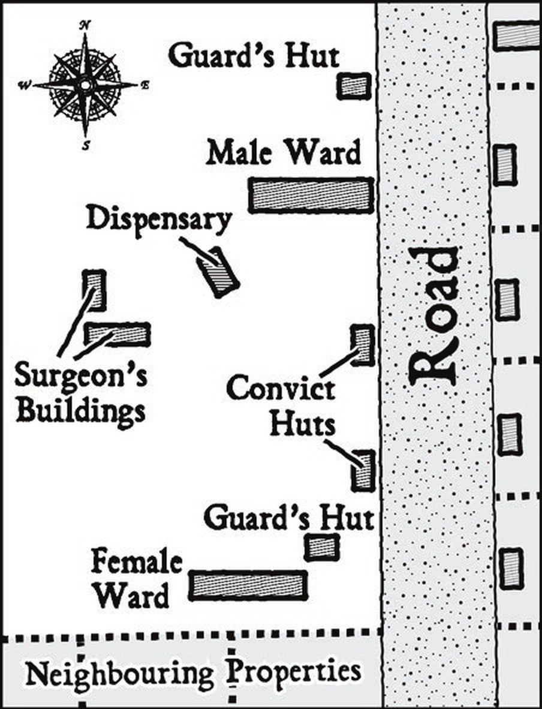

в 1811 году, оставив вдову Ребекку, их сына и двух дочерей, а также пятерых дочерей от каторжницы Элизабет Колли на острове Норфолк и ещё одного сына от каторжницы Сары Плейс.

# Больница в Парраматте

> *«Не думаю, чтобы где-либо было место, столь полное нужды, распутства и всякого порока, как общая больница в Парраматте»*
>
> — преподобный Сэмюэл Марсден в письме в Колониальное ведомство, 1818 год

Сценарий, составляющий вторую половину этого «Отпускного билета», вращается вокруг больницы Парраматты. В эпоху «Convicts & Cthulhu» это сравнительно недавно построенное здание, которое заменило куда более примитивное заведение.

Первой больницей Парраматты была «палаточная больница», работавшая с 1788 по 1792 год; на деле это была не палатка, а две длинные постройки под соломенной крышей, отдалённо похожие на палатки и вмещавшие 200 больных. Когда население Парраматты превзошло население Сиднея, понадобилось более основательное здание с лучшими удобствами.

Больница эпохи «C&C» — группа построек из глиняного кирпича, оштукатуренных и побелённых, — была построена в 1791 году, и больных перевели в неё в декабре того же года. Всего в больнице две палаты.

*Прим. перев.: так в оригинале — «палаточная больница» работала до 1792 года, а новую больницу построили и заняли в декабре 1791 года.*

К сожалению, из-за недостатков строительных материалов — в кирпичах не хватает известняка, и потому они крошатся — больница уже изрядно обветшала. В конце концов её снесут лет через десять после эпохи «C&C». Исторические сведения об этой больнице скудны и в основном получены благодаря работе археологов, лишь недавно раскопавших фундаментные камни здания. Приблизительная карта больницы (по всем известным историческим данным) помещена рядом.

**Ключ карты «Карта больницы Парраматты»:** Guard's Hut — караульная хижина (северная); Male Ward — мужская палата; Dispensary — аптека; Surgeon's Buildings — постройки хирургов; Convict Huts — хижины каторжников; Guard's Hut — караульная хижина (южная); Female Ward — женская палата; Road — дорога; Neighbouring Properties — соседние участки.

## Постройки больницы

Все постройки сложены из глиняного кирпича, оштукатурены и побелены, но все они разрушаются из-за нехватки известняка в смеси. Потолки в постройках низкие, освещения нет. Ни на одной двери нет ни замков, ни засовов, так что люди приходят и уходят когда вздумается.

На территории больницы стоят следующие постройки (их расположение — на карте):

- **Две палаты (мужская и женская).** По правилам общение полов не допускается, но на деле за этим трудно уследить. Палаты страшно переполнены, условия мерзкие. Окна разбиты, а крыша протекает, стоит дождю пойти чуть сильнее. В одном конце палаты хранятся припасы, но здесь мало что есть, кроме самого необходимого, а часто нет и этого (рис и чай больным особенно не хватает). Нередко умерших больных на время оставляют в их постелях, потому что мертвецкой в больнице нет.
- **Две караульные хижины.** Стоят рядом с палатами. Караульные обычно — надсмотрщики из каторжников, изредка — солдаты Корпуса Нового Южного Уэльса.
- **Аптека.** Здесь хранятся снадобья и лекарства, но их довольно мало, и многие полки пусты. Как и другие постройки, аптеку нельзя запереть, так что кражи здесь обычное дело.
