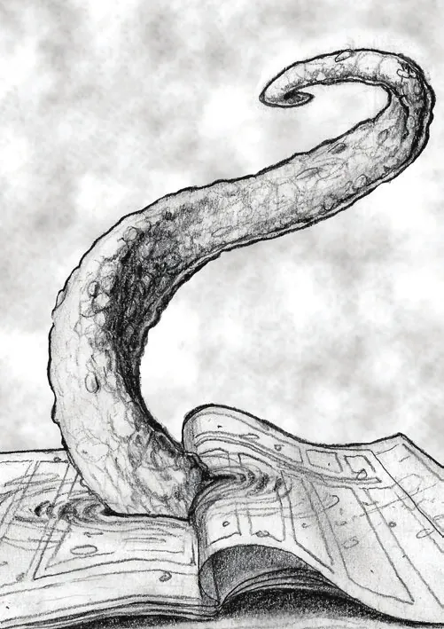

некоторых самых странных превращениях, которые она успела вызвать, дошли до колониальных властей.

Однако Тварь в книге не довольствуется тем, чтобы просто выжидать возвращения своего ученика. Втиснутая в книжный шкаф в задней комнате, куда почти никто не заходит, злая сущность мысленно тянется к любому разуму, до которого может дотянуться. До недавнего времени ей удавалось коснуться лишь разума каторжницы Мэгги, которая любит заглядывать в кладовую всякий раз, когда удаётся улизнуть с работы на короткий перерыв, — покурить или предаться другим порокам. Хотя Мэгги — не идеальный выбор, Книга подумывала завладеть девушкой… но в последние дни та стала приводить в кладовую мужчину. Дело в том, что, хотя Мэгги и была любовницей Макдеда, она уже какое-то время была и любовницей коварного больничного санитара по имени Джон Уайли. Теперь у Книги есть два кандидата, которых можно опутать… и лишь вопрос времени, когда один из них (или оба) поддастся её влиянию, прочтёт книгу и станет новым творцом медицинских бесчинств. Тогда путь к её конечной цели вновь пойдёт полным ходом…

> ## Фармакопея
>
> Книга, вокруг которой творятся все эти странности, — толстая, потрёпанная на вид фармакопея (dispensatory — сборник медицинских прописей, то есть лекарств и других препаратов, и способов лечить ими разные болезни). Похожие книги иногда называют также pharmacopoeia.
>
> Хранители, желающие добавить в игру исторического правдоподобия, легко найдут в сети бесплатные сканы фармакопей того времени, полные причудливо звучащих способов лечения. «Фармакопея проклятых» Макдеда особенно навеяна «Новой Эдинбургской фармакопеей» (The Edinburgh New Dispensatory), которая собрала в один огромный том разные фармакопеи, в том числе эдинбургскую, дублинскую и лондонскую. Эта книга стала одним из главных трудов реформы химической фармации эпохи Просвещения. Серию начал доктор Уильям Льюис в 1753 году. (Ссылка на полную онлайн-версию, выложенную Национальной медицинской библиотекой США, приведена ниже.)
>
> Книга делится на три главных раздела:
>
> - Раздел первый посвящён химическим веществам и элементам, а также фармацевтическим операциям — взвешиванию, отмериванию, нагреванию и соединению с другими химическими веществами.
> - Раздел второй — *Materia Medica*: в нём рассматриваются вещества животного, растительного и минерального происхождения, используемые в фармации, и то, против каких недугов они в целом действенны.
> - Последний раздел, «Приготовления и составы», рассказывает, как эти вещества соединяют в лекарства и с какой целью.
>
> Иллюстрации из этого настоящего медицинского труда разбросаны по всему этому «Отпускному билету».

## Как вовлечь сыщиков

Сыщики вступают в дело, когда колониальные власти решают, что кому-то следует разобраться в волне странных историй, связанных с медициной, которые ходят по колонии. Одну-две диковинные байки о странных мутациях можно списать на ложь, беспробудное пьянство или разыгравшееся воображение, но целый ряд независимых друг от друга рассказов требует расследования.

Проще всего ввести сыщиков в дело, если они уже как-то связаны с медицинским ведомством Нового Южного Уэльса. Связь может быть и непрочной: например, они могут быть каторжниками,
