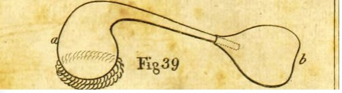

Прибыв в Парраматту, отряд, возможно, будет рассчитывать поселиться прямо в больнице Парраматты, но эти надежды быстро рухнут. В скромном лечебном заведении для них нет свободной комнаты, и отряду придётся искать жильё в местном трактире (если только кто-то из сыщиков не живёт в Парраматте или не имеет поблизости друзей или союзников). Если Хранителю нужен типичный трактир, для этого подойдёт «Масонский герб», описанный в основной книге «C&C».

## Расследование в Парраматте

У сыщиков в Парраматте есть несколько путей расследования. Они могут собирать общие слухи, что ходят по городу, — эти рассказы шепчут даже среди персонала и больных больницы. Или же они могут попытаться разыскать четверых людей, чьи имена значатся в списке Джеймисона.

### Расследование в больнице Парраматты

Хотя больнице предстоит стать средоточием грядущих событий, поначалу узнать здесь можно очень немногое. Расспросы о странных медицинских симптомах или иных странностях не дадут никаких подробностей. Разумеется, среди несчастных, которых лечат в больнице, необычных случаев не наблюдалось, хотя большинство слышали кое-какие сплетни, что ходят по городу (см. ниже).

Главные из персонала больницы, с кем сыщикам придётся иметь дело, — главный хирург больницы Парраматты (кто занимал эту должность в год действия сценария, см. во врезке «Хирурги Парраматты» на с. 7) и ещё несколько человек, описанных ниже:

- **Главный хирург больницы.** Этот врач подчиняется непосредственно колониальному хирургу в Сиднее и, как правило, охотно идёт сыщикам навстречу — по крайней мере, пока они не слишком посягают на его время и медицинские припасы. Он отмахивается от диких россказней о странной болезни и прямо заявляет, что не видел, чтобы в больницу обращался кто-либо с чем-то необычным. Если спросить, проверял ли он слухи, что ходят по Парраматте, он отрывисто ответит, что слишком занят, чтобы проверять безумные слухи!
- **Помощник хирурга.** Кроме главного хирурга, в больнице есть врач помладше — Барнабас Риттер, который должен находиться в больнице в светлое время суток. Сыщики могут изредка замечать Риттера, но, похоже, большую часть времени его нет на месте. На деле у молодого доктора немало пороков (ром, женщины и табак — лишь начало длинного списка), которым он любит предаваться в городе всякий раз, когда «в больнице, кажется, всё под контролем». А это, похоже, бывает всякий раз, когда ему того захочется. Впечатление сыщиков, что помощник хирурга числится в больнице разве что для виду, укрепится, когда они узнают, что, хотя доктору Риттеру и отведены в больнице комнаты для жилья, он никогда ими не пользуется. Все эти подробности хорошо известны большей части персонала (и некоторым больным) больницы. То, что хирургической Риттера и примыкающей к ней кладовой почти не пользуются, дало Мэгги Майлз удобное место, чтобы спрятать Книгу (а позже может стать удобным местом для дополнительных хирургических операций).
- **Санитар-каторжник Джон Уайли.** Уайли 39 лет, он родом из Бирмингема. Он выполняет в больнице всякую подсобную работу — в основном убирает и таскает тяжести. Сыщики будут часто сталкиваться с ним, перемещаясь по больнице. Помимо работы, Уайли проворачивает несколько прибыльных махинаций и время от времени крутит роман с сиделкой Майлз (см. ниже). Если спросить, Уайли утверждает, что служил санитаром в армии, но это ложь, и под нажимом он с трудом может припомнить хоть какие-то подробности своей службы, кроме того, что «бился с французами». Уайли ревниво оберегает Мэгги и, если его разозлить, вполне может пустить в ход кулаки. (Подробнее о роли Уайли в дальнейших событиях сценария — на с. 19.)

