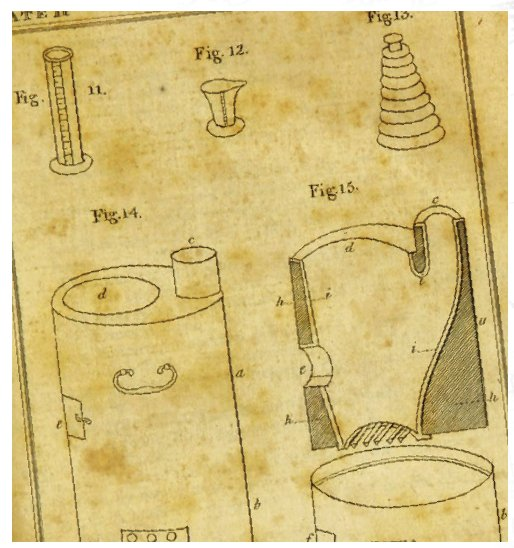

хотя некоторые — лишь недавно. У всех четверых дело зашло так далеко, что перемены разорвали их рассудок в клочья, и большинство из них больше не выходят из дома из страха, что кто-нибудь заметит, как изменилось их тело. Если превращение зашло особенно далеко, то, вероятно, родные больного либо тоже сошли с ума, либо бежали, бросив растущий ужас на произвол судьбы. Сбежавшие, скорее всего, прячутся, всё отрицают и ничуть не желают связываться с властями.

Хранитель может по описаниям ниже импровизировать подходящие жуткие или жалкие сцены, которые ждут сыщиков в домах каждой из четырёх жертв. От самих больных сыщики, скорее всего, узнают очень мало (их разум давно надломился); большую часть сведений они соберут в разговорах с родными и друзьями. Сыщики вольны попытаться поставить жертвам медицинский диагноз (и пройти проверки подходящих навыков), однако узнать по-настоящему можно лишь одно: ни одна из этих странных мутаций не похожа ни на одну болезнь, описанную в обычной литературе.

#### Томас Брэдбери

Брэдбери 53 года, он живёт в доме в городке Парраматта. Он каторжник-работник, приписанный к ферме Джона Айсли и его семьи. Месяц назад Брэдбери жаловался на кашель и обращался к доктору Макдеду.

Когда сыщики приходят в дом Брэдбери, дверь им открывает его жена, которая неохотно принимает гостей. Она кажется убитой горем, а в доме стоит страшная вонь. Если её удастся уговорить впустить их, сыщики увидят Брэдбери — пустую оболочку прежнего человека, из затылка которого торчит жилистая зелёная ложноножка. Жена говорит, что под одеждой у него есть второе такое щупальце. Он ни на что не отзывается и смотрит куда-то вдаль.

#### Мэри Харт

Мэри — свободная поселенка 29 лет, жена Джорджа Харта. Они живут на своей ферме в Тунгабби. Шесть недель назад Мэри упала и подвернула ногу, а потом слегла с лихорадкой. Доктора Макдеда вызвали на ферму лечить её.

Когда сыщики приезжают на ферму, там стоит тишина, и на их стук никто не отвечает. Мистер Харт и работники фермы в страхе сбежали (и прячутся на соседних фермах). Если сыщики войдут сами, они легко найдут несчастную миссис Харт — их приведёт ужасный запах, пропитавший весь дом. В углу хозяйской спальни лежит огромный зеленовато-белый кокон, похоже, пролежавший здесь уже несколько дней. Поверхность защитной оболочки, по-видимому, недавно вскрыта — судя по всему, изнутри, — и из дыры торчит наполовину человеческая, наполовину насекомья голова. Это и есть жертва: она недавно завершила своё первое превращение, но так ослабла от истощения, что не может выбраться из кокона. Её мутация зашла дальше всех.

Хотя больше в доме никого нет, сыщики могут поговорить с соседями на ближних фермах (и даже найти прячущегося мужа), чтобы узнать историю недуга миссис Харт и её лечения.

#### Уильям Грин

Грин — девятнадцатилетний юноша-каторжник, работающий батраком у сержанта Корпуса Нового Южного Уэльса Джозефа Митчелла. Он живёт у сержанта Митчелла в его маленьком доме в городке Парраматта. Последние недели сержант Митчелл не живёт в своём доме: его направили на службу в другое место. Однако его служанка-каторжница Элинор Чайлдс всё это время
