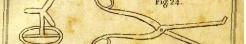

оставалась в доме и видела, что происходило с Грином. Поначалу Уильям жаловался на головные боли и тошноту и ходил к доктору Макдеду в его домашнюю приёмную на дороге в Тунгабби.

Придя в дом Митчелла, сыщики обнаружат, что служанка Элинор крайне расстроена: она в отчаянии упрашивает в казармах Корпуса Нового Южного Уэльса передать сержанту Митчеллу, что ему необходимо вернуться и разобраться с делом «некоторой срочности». Поначалу Элинор будет противиться любым попыткам войти в дом, говоря, что хозяин велел ей при необходимости защищать его имущество силой. Если сыщики уговорят её или вломятся в дом силой, они найдут Уильяма Грина — безумного, с чудовищно искажённым черепом, который начал расходиться под давлением чего-то растущего внутри. Заглянув в трещины, сыщики увидят, что внутри черепа сидит огромный пульсирующий мозг.

#### Энн Гейбл

Энн — каторжница 44 лет, она работает у фермера Джеремайи Петтитта и его семьи и живёт на их ферме в Роуз-Хилле. Сначала Энн жаловалась на головные боли и лихорадку, и после долгих уговоров фермер убедил её позвать доктора Макдеда.

Приехав на ферму Петтиттов, сыщики обнаружат, что в доме остался только мистер Петтитт. Если на него надавить, он скажет (солгав), что его служанка уехала в Сидней навестить кузину. На деле Джеремайя спрятал Энн на сеновале большего из амбаров фермы, потому что слишком боится того, во что она превращается. По той же причине он отослал жену и работников-каторжников фермы. Сыщикам, желающим осмотреть Энн Гейбл, придётся либо пробить стену лжи этого человека, либо тщательно обыскать все постройки фермы. Если они найдут её (тем или другим способом), Джеремайя Петтитт разражается слезами, снова и снова повторяя: «Не надо было мне велеть ей звать лекаря».

*Прим. перев.: в оригинале — «если они найдут его жену»; по смыслу речь об Энн (жену Петтитт отослал с фермы).*

В своём укрытии в амбаре Энн — слюнявая пародия на женщину. Её торс начал искривляться и твердеть, как панцирь какого-то огромного насекомого. Из спины торчат громадные шипы.

#### Улики и сведения

Разговоры с родными и друзьями больных могут раскрыть несколько подробностей. Хранитель должен решить, требуют ли некоторые из этих фактов проверок навыков, чтобы вытянуть их из убитых горем родственников. Каждый разговор должен открывать лишь пару пунктов, чтобы сыщикам пришлось складывать полную картину из множества разных рассказов.

- Каждая из жертв была пациентом частного доктора из Парраматты, известного как «доктор» Джеймс Макдед;
- Каждое из семейств за последние четыре недели покупало товар у речника в красной лодке;
- Большинство родных вообще боятся больницы Парраматты и её хирургов и говорят, что не пошли бы к ним, разве что оказавшись на пороге смерти. (Этот страх рождён общим недоверием к властям, хотя сыщики могут поспешить с ошибочным выводом, будто больница и её хирурги как-то замешаны);
- Пострадавшие больные уже давно лечились у доктора Макдеда, и каждый прежде получал от него лечение без всяких дурных последствий;
- На последнем приёме у доктора Макдеда больные получили снадобье, которое, как сказал им доктор, облегчит их недуг. Все больные приняли данные им лекарства;
- Паре больных доктор упомянул, что выбранное им особое лечение — «прогрессивное и новое», найденное, когда он сверялся с новой книгой, — и что он уверен: это новое лечение даст чудесные результаты;
- После того как им дали лекарство, ни один больной больше не приходил к доктору, и он ни к кому из них не приходил;
- Один из родственников, с которыми говорят сыщики, охотно признает, что Макдед «не совсем доктор», но, несмотря на это, у него редкий дар помогать при всевозможных мелких хворях; все его лечения прежде действовали, и притом куда надёжнее, чем лечение в больнице;
