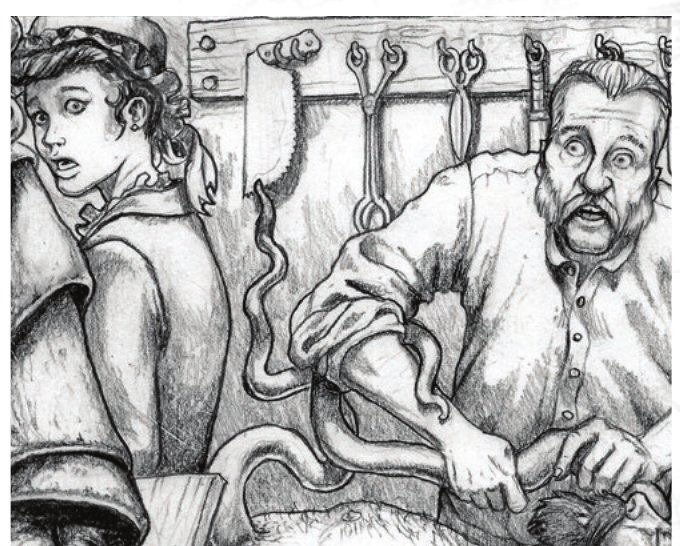

### Продажная сиделка: Мэгги Майлз

До приезда сыщиков в Парраматту Мэгги сама Книгу не изучала, хотя охотно участвовала в прежних безумных затеях Макдеда. Она верит, что доктор нащупал нечто поистине великолепное, а его замыслы дают волю её собственной жестокости и желанию возвыситься над другими. Однако она достаточно умна, чтобы бояться Книги, и достаточно хитра, чтобы постараться подставить под удар других, а не браться за книгу самой.

Как только сыщики начнут вынюхивать что-то в больнице, Мэгги поймёт, что пора действовать. Для начала она попытается убедить Уайли, что можно неплохо заработать, если по рецептам из старой книги Макдеда готовить ту же безобидную дрянь, которой торговал Макдед. Её цель — либо вынудить Уайли самому всерьёз взяться за «тайную медицинскую книгу», либо сделать его «соучастником» (на выбор Хранителя).

Мэгги не особенно хочется становиться главным орудием Книги, и она постарается подстроить всё так, чтобы эту роль взял на себя кто-то другой. Если ей не удастся заинтересовать Уайли, она может прицепиться к какому-нибудь каторжнику в больнице, у которого есть кое-какие медицинские знания, и попытаться сделать его новым рабом Книги. Или же она может как-нибудь устроить так, чтобы Книга оказалась на столе у помощника хирурга Барнабаса Риттера в один из тех редких дней, когда он работает у себя в кабинете. На худой конец она может даже подстроить так, чтобы на Книгу в уединённом месте наткнулся сыщик, сведущий в медицине, — в расчёте на то, что разум этой зловещей твари быстро завладеет им и подчинит его своей воле.

### Злонамеренный санитар: Джон Уайли

Как сказано выше, Уайли — самый очевидный человек, которым может вертеть Мэгги. Если Хранитель решит, что в конце концов санитар поддастся жадности, он быстро станет новым рабом Книги. Это заметно изменит его поведение. До того как им овладели, Уайли — обычный хитрый задира. Потом он становится замкнутее и неустойчивее душевно и временами срывается в необъяснимое насилие.

Став одержимым, Уайли возобновит осуществление замысла Книги, стремясь довести число превращённых «Отворяющих врата» хотя бы до девяти (столько нужно для последнего ритуала). В отличие от Макдеда, который довольно старательно следил, чтобы его жертвы были разбросаны по широкой округе, Уайли не хватает ума действовать тонко. Он просто выбирает жертвы наугад среди нынешних пациентов больницы Парраматты. После «лечения» он уводит своих жертв из общих палат — якобы чтобы изолировать их и не допустить заразы. На самом же деле он просто прячет их в кладовой здания помощника хирурга, загораживая дверь снаружи тяжёлым книжным шкафом. Из-за общей неразберихи, охватившей больницу (возможно, созданной самими сыщиками), пройдёт несколько дней, прежде чем кто-нибудь из начальства узнает об этих самовольных «лечениях».

### Безумный доктор: Джеймс Макдед

Макдед — козырь в рукаве, которым Хранитель может по-разному приправить разворачивающийся кризис. Как сказано в разделе о Коул-Ривер (см. с. 17), он постарается бежать из заключения. Если Хранитель выбрал вариант Мифов C («Возвышение доктора Макдеда»), ему, возможно, даже окажут в этом немалую помощь.

Если Макдед обретёт свободу, его неодолимо потянет обратно к Книге — её влияние по-прежнему впивается когтями в его разум. Путь по суше из Коул-Ривер в Парраматту был бы геркулесовым подвигом, но и он не невозможен (исторически нескольким каторжникам действительно удалось добраться из Коул-Ривер до поселений на Хоксбери, а там и до «цивилизации»). Конечно,
