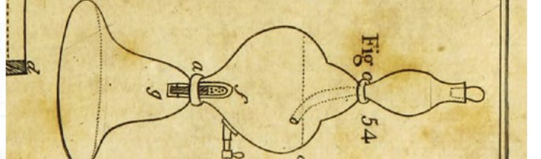

Если это случится, ужасное и омерзительное лоскутное существо убьёт всех, кто его увидит, и уйдёт в глубинку. Там оно затаится и будет посылать психические послания легковерным и злым, чтобы колония развивалась всё более жестокой и порочной. Добрый Хранитель может позволить сыщикам пойти по его следу разрушений и хаоса и бросить ему вызов в глубинке, но, скорее всего, оно скроется из виду, а его зло просто просочится в ткань рождающейся колонии. Время от времени будут рождаться отвратительные уродцы, чем-то похожие на Гештальт-сущность.

**Дополнительная улика:**

- Родные некоторых частично превращённых жертв Макдеда слышали, как те порой произносят фразы на каком-то странном чужом языке. Знатоку Мифов Ктулху эти бессмысленные фразы подскажут связь с определённым богом Мифов — тем, для которого Вестник строит новое тело.

## Вариант C: Возвышение доктора Макдеда

При этом варианте шарлатан доктор Макдед с самого начала был жертвой культа Мифов. Избрав его для своих оккультных целей — проложить им дорогу в Новом Свете, — эта группа подстроила события так, чтобы его схватили в Лондоне и приговорили к ссылке. Когда он обосновался в колонии и завёл себе репутацию сомнительного лекаря, культ устроил так, чтобы «Фармакопею проклятых» тайком добавили к содержимому ящика, присланного родственником из Лондона. Члены культа прекрасно знают, какой подлинный ужас таится на страницах книги и чем, скорее всего, обернётся для слабовольного доктора её влияние. До сих пор их замысел сделать Макдеда ничего не подозревающим орудием тьмы в основном шёл по плану… хотя приговор, отправивший вороватого доктора в Коул-Ривер, — конечно, помеха.

Тёмное общество, стоящее за этим заговором, называется Культом Прогорклого Тома; это теневая группа, которая видит в южном континенте место, где смогут процветать её мерзкие верования и сущности, которым она служит. Весьма вероятно, что у этой порочной организации уже есть члены среди каторжников или вольных жителей колонии — кто именно действует в её интересах, решает Хранитель. Таким агентам, скорее всего, поручено присматривать за Макдедом и убивать всякого, кто мешает его успехам. Более того, такие агенты, вероятно, будут добиваться либо отмены его заключения в Коул-Ривер, либо, быть может, устроят ему «побег» из каторжного поселения, чтобы он мог вернуться к своей работе в Парраматте.

Хотя именно почитатели Прогорклого Тома запустили ход событий, теперь, когда Макдед вышел из игры, а Книга начала оказывать своё тёмное влияние на других, события начинают развиваться сами собой. Культ, скорее всего, не знает об этом повороте, но, вероятно, всё равно приветствовал бы его как удачный: раз в мир приходят ужасы, им не важно, чьими руками. Единственная причина, по которой они сами не пользуются силой Книги напрямую, — то, что они знают (по горькому опыту): владеть её силой — смертный приговор (см. ниже).

Если замыслам Книги дадут осуществиться, её нынешний раб будет вынужден собрать девятерых мутировавших людей и под покровом ночи отвести их туда, где сейчас строится церковь Парраматты. Среди фундамента святого здания раб будет вынужден заживо резать самого себя, отрезая куски собственного тела, чтобы скормить их превращённым «Отворяющим врата». Каждое искажённое человеческое существо, съев часть плоти раба, проходит второе превращение и становится служителем Мифов (Хранитель может выбрать какой-нибудь вид существ человеческого роста или просто использовать Приёмышей Древних, описанных на с. 40—41 *Malleus Monstrorum*). В конце этого кровавого ритуала раб вонзает себе в сердце скальпель. Девять созданных так ужасов Мифов выпускают на улицы Парраматты — убивать и пожирать в диком исступлении.

По иронии судьбы, заключение доктора Макдеда может привести к тому, что этот великий замысел осуществится (чужими руками) раньше, чем он сумеет вернуться в Парраматту. В таком случае, когда пыль уляжется, культ станет почитать доктора как своего «тёмного мессию» — и он, скорее всего, станет их
