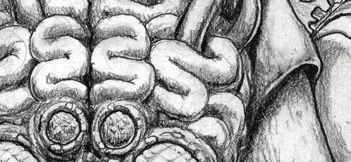

## Тварь из «Фармакопеи проклятых»

Фармакопеей доктора Макдеда владеет это отвратительное создание — мерзкое чудовище, служащее высшим силам и не желающее ничего, кроме как привести на Землю своих ужасных хозяев, чтобы те резвились и пировали. Ради этого оно подчиняет читателей книги, в которой обитает, и заставляет их создавать чудищ, чьи телесные и душевные свойства годятся для «Отворяющих врата».

У Твари две физические формы. Большую часть времени она похожа на гнойную, злокачественную версию книги, в которую решила вселиться. С виду книга кажется обычной, но при внимательном рассмотрении видно, что она какая угодно, только не обычная (см. особые способности ниже). Однако под угрозой Тварь возвращается к своему истинному облику — длинноногой насекомьей твари с огромным пульсирующим мозгом, из которого тянутся щупальца. Обычно Тварь меняет облик, только когда на неё нападают физически, а её способность мысленно овладевать людьми не помогла.

В любой форме Тварь может общаться только мысленно — кроме этой телепатии, она способна лишь на тревожное бормотание и щелчки.

```stat
СИЛ 0/150*    ВЫН 100    ТЕЛ 1/200    ЛВК 0/60    ИНТ 80
МОЩ 100    ПЗ 10/30
БкУ: −2/+3d6    Комплекция: −2/4    Скорость: 0/7    ПМ: 100

* Число до косой черты — для формы книги, после косой черты — для истинной, насекомьей формы твари.
```

*Прим. перев.: так в оригинале — у истинной формы БкУ +3d6 и Комплекция 4, хотя при СИЛ 150 и ТЕЛ 200 (сумма 350) ожидается +5d6 и 6; ПМ 100 при МОЩ 100 (ожидается 20). Оставлено как напечатано.*

**Атаки**

Атак за раунд: 1.

**Боевые атаки.** Тварь может физически защищаться, если на неё нападают, но для этого должна принять свой истинный облик. Как только она приняла истинный облик, книга, в которой она обитала, уничтожается, и Тварь должна найти другую за 1d3 дня — иначе засохнет и умрёт.

```stat
Клешня            60% (30/12), урон 1d6 + БкУ
Удар щупальцем    40% (20/8), урон 1d8 + половина БкУ
Уклонение         60% (30/12)

Броня: 6 очков хитинового панциря в любой форме.
Потеря Рассудка: 1/1d4 за то, чтобы увидеть злокачественную форму книги; 1d4/1d10 за то, чтобы увидеть истинный облик Твари.
```

**Особые способности**

**Вселение в книгу.** Тварь может вселиться в любую книгу, но предпочитает трактаты по химии (или алхимии) и медицинские учебники: они лучше передают тёмные знания, которыми она владеет, — о воссоздании жизни так, как это лучше всего служит цели её Хозяина. Чтобы полностью поглотить книгу, Твари нужен час, и всё это время ей нельзя мешать. После этого она может придать книге-носителю невинный вид, но эту иллюзию можно разгадать. Всякий, кто преуспеет в проверке МОЩ или 1d3 минуты внимательно рассматривает книгу, увидит сквозь иллюзию гнойную, омерзительную пародию на книгу, в которую вселилась Тварь (за то, чтобы увидеть эту форму, нужна проверка Рассудка, см. ниже).

**Овладеть читателем.** Главное назначение Твари в книге — овладеть читателем текста, в котором она обитает. Для этого читатель должен внимательно читать книгу не меньше 1d6 минут. После этого читатель должен пройти встречную проверку МОЩ против МОЩ Твари — иначе станет её рабом. Те, кем Тварь овладела, начинают пользоваться тайной магией книги, чтобы создавать мутантов, которые могут служить «Отворяющими врата». Они вынуждены это делать, а сопротивление стоит им 1d3 ПЗ в день, пока они не сдадутся или не умрут.

**Превратить в Отворяющего врата.** Овладев читателем, книга стремится заставить этого человека создать для неё девять «Отворяющих врата», чтобы использовать их в последнем ритуале. Для этого одержимый будет вынужден находить жертвы и с помощью силы книги превращать их омерзительными и странными способами. Для этого одержимый читатель должен по тайным указаниям книги изготовить вещь или состав, который будущая жертва затем должна надеть или проглотить. После соприкосновения с заразной вещью телесное превращение начинается через 1d6 дней и завершается ещё через 4d4 дня. Обычно превращение сводит жертву с ума (хотя добрый Хранитель может дать жертве проверку Рассудка с потерей 1d4/1d20).


