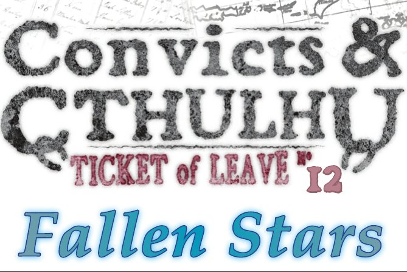
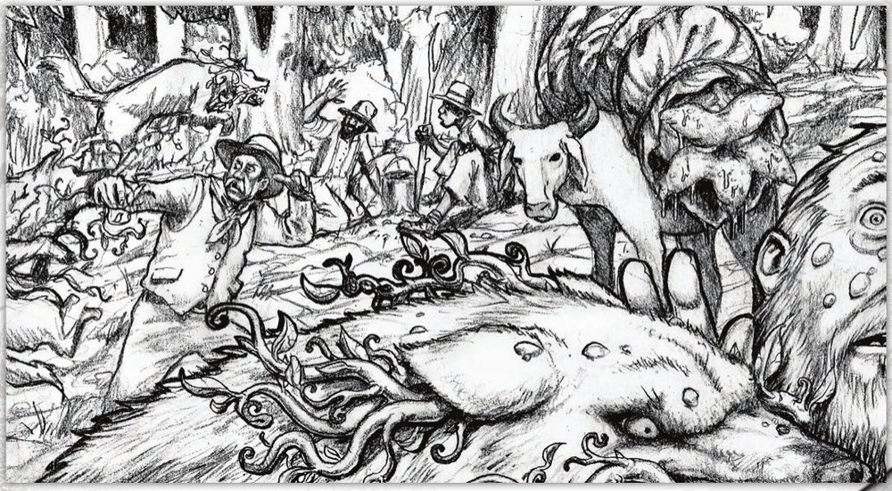

ПАДШИЕ ЗВЁЗДЫ

Convicts &amp; Cthulhu — Отпускной билет № 12

*Вверху страницы — логотип «Convicts & Cthulhu — Ticket of Leave № 12» и заглавие «Fallen Stars» («Падшие звёзды») на фоне старинных рукописных карт.*

> «Отпускные билеты» (Tickets-of-Leave) — небольшие самостоятельные дополнения к сеттингу «Convicts & Cthulhu» для лавкрафтовских ролевых игр в ранних каторжных колониях Австралии. В каждом — подборка игровых элементов: их можно использовать все вместе как набросок мини-сценария или по отдельности — как детали, которые обогатят сценарий вашего собственного сочинения.

<!-- -->

> **Выходные данные**
>
> «Отпускной билет» № 12 написал Мэтью Руэйн (Matthew Ruane) при участии Джеффа Гиллана (Geoff Gillan); оригинальные иллюстрации — Рубен Додд (Reuben Dodd). © 2018. PDF издаёт Cthulhu Reborn Publishing (www.cthulhureborn.com).
>
> Сеттинг «Convicts & Cthulhu» издаёт Cthulhu Reborn Publishing; он доступен на RPGNow и DrivethruRPG по модели «Плати сколько хочешь» (Pay-What-You-Want).
>
> В этом PDF используются товарные знаки и/или авторские права Chaosium Inc./Moon Design Publications LLC — по правилам Chaosium для фанатских материалов (Fan Material Policy). Нам прямо запрещено брать плату за использование этого материала или доступ к нему. Этот PDF не издан, не одобрен и не утверждён Chaosium Inc. Подробнее о продукции Chaosium Inc. — на www.chaosium.com.
>
> Лицензия Creative Commons BY-NC-SA.

# Введение

Когда европейцы впервые поселились в Новом Южном Уэльсе, их заботило прежде всего одно — с нуля наладить работающее каторжное поселение. Поэтому исследовать странную новую страну, лежавшую за пределами крошечных посёлков, им было не слишком интересно. Однако со временем становилось всё яснее, что каторжная колония — не недолговечная тюрьма, а постоянное британское колониальное владение, и всё начало меняться. К эпохе «Convicts & Cthulhu» и среди колониального правительства, и среди частных свободных поселенцев есть немало важных людей, которые видят смысл в том, чтобы заполнить белые пятна на картах и побольше узнать об этом необычном материке, который они теперь зовут домом.

Тягу к исследованию диких краёв Нового Южного Уэльса определяют две главные причины: нужда в пахотной земле для растущего поселения и научное любопытство — в особенности к уникальной флоре и фауне Австралии. Главное препятствие для ранних исследований — высокий горный хребет, запирающий колонию с запада, — величественные Голубые горы. Несмотря на многочисленные попытки, удобного перевала, по которому колонисты могли бы перейти эти горы, пока не нашли. Поэтому земли за ними остаются полной тайной… если не считать явно выдуманных каторжных рассказов о великих внутренних морях или королевствах белокожих жителей. Ведь это никак не может быть правдой? Конечно же нет.

