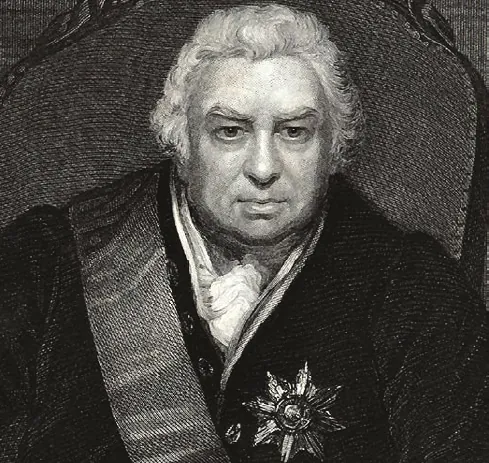

> **Сэр Джозеф Бэнкс (1743—1820)**
>
> Сэра Джозефа Бэнкса всю жизнь связывали с Австралией тесные узы. Началось всё с того, что он вошёл в экспедицию капитана Джеймса Кука, которая в 1770 году впервые открыла неуловимое восточное побережье материка.
>
> Бэнкс учился в колледже Крайст-Чёрч в Оксфорде и ещё до того стал натуралистом с горячим личным интересом к ботанике. Ботанику он изучал с помощью преподавателей и Кембриджа, и Оксфорда, но в конце концов, как и многие другие джентльмены той эпохи, покинул университет без степени. Тем не менее наследство позволило ему посвятить жизнь изучению всех сторон мира природы.
>
> В 1760-х годах он лично сопровождал экспедицию в Северную Америку — прежде всего на Ньюфаундленд и в Лабрадор, — где собрал коллекцию артефактов и образцов растений и животных. В 1768 году Бэнксу позволили присоединиться к Куку в его первой экспедиции в Тихий океан; натуралист взял с собой свиту из восьми человек, но пережить плавание и вернуться в Англию суждено было лишь четверым, включая самого Бэнкса.
>
> В следующем, знаменитом плавании Кука, полном открытий, Бэнкс снова был с ним и стал одним из первых англичан, ступивших на австралийскую землю, — он высадился в Ботани-Бей весной 1770 года. Позже в той же экспедиции, в начале лета, он высадился у реки Индевор, где собирал «экзотические» образцы растений и животных и подробно записывал наблюдения во множестве тщательнейших дневников.
>
> *Прим. перев.:* на деле высадка в Ботани-Бей в 1770 году — это то же первое плавание Кука (1768–1771), а не следующее.
>
> Вернувшись в Англию в июле 1771 года, Бэнкс взялся за изучение своих образцов. Он также стал убеждать Палату общин основать в Австралии колонию и каторжное поселение. Когда в 1788 году поселение было основано, Бэнкс завёл постоянную переписку со всеми колониальными губернаторами, добиваясь сбора всё новых образцов животных и растений. Их часто отправляли обратными рейсами в Англию, чтобы Бэнкс изучал их там.
>
> Многие современники считали Бэнкса главным английским знатоком Нового Южного Уэльса, и он оставался тесно связан с ростом и расширением колонии до самой смерти. Он поощрял натуралистов и ботаников сопровождать многочисленные правительственные исследовательские экспедиции, а также сам платил своим людям за поездки и сбор образцов для изучения.
>
> В кампании «Convicts & Cthulhu» сэр Джозеф Бэнкс — пусть даже за тысячи километров — станет отличным покровителем для сыщиков-учёных. Он может оказывать денежную или политическую поддержку тем, кто снаряжает ботанические или зоологические экспедиции в Австралии. Многие капитаны кораблей и ранние первопроходцы вели обширную переписку с Бэнксом, оставшимся в Лондоне, и знали, что богатый учёный щедро платит за сведения и образцы, проливающие свет на флору и фауну Нового Южного Уэльса, остальной Австралии и Южных морей.
>
> (Источник: http://adb.anu.edu.au/biography/banks-sir-joseph-1737)

С самого основания колонии Новый Южный Уэльс в Голубые горы ходили экспедиции в поисках перевалов через вершины, но по-настоящему преуспеть никому не удастся до окончания эпохи «Convicts & Cthulhu». Общепринятая история гласит, что белые поселенцы нашли дорогу на равнины за горами лишь благодаря экспедиции Блаксленда, Уэнтуорта и Лоусона в 1813 году.

Это вовсе не значит, что края вокруг Голубых гор не были целью более ранних исследовательских походов. И, смотря чьим рассказам верить, вполне может оказаться правдой, что разношёрстная экспедиция во главе с диковатым каторжником сумела найти путь в обход гор лет на пятнадцать раньше почтенных джентльменов-первопроходцев Блаксленда, Уэнтуорта и Лоусона.
