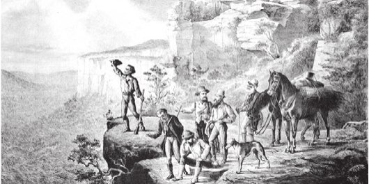

…тревожили власти, ведь они давали каторжникам надежду: если удастся бежать, в этом вымышленном поселении можно найти надёжное убежище. Хантер решил раз и навсегда опровергнуть эти байки, отправив отряд в то место, где якобы было поселение. Вести экспедицию он поручил Джону Уилсону; в остальном отряд состоял из Джона Прайса, 19-летнего слуги губернатора, нескольких вооружённых солдат Корпуса Нового Южного Уэльса и четверых ирландских заключённых. Отряд выступил в 1798 году. Каторжники и их охрана вскоре повернули назад, но Уилсон и Прайс пошли дальше.

По их рассказу, двое переправились через реку Непин и исследовали край к юго-западу, ища проход через Голубые горы. Такого перевала они не нашли, но в конце концов отыскали путь в обход Голубых гор с юго-запада. В марте 1798 года они продолжали исследовать этот край и, вероятно, открыли озёра Тирлмир. Они дошли почти до места нынешнего Гоулберна, а затем повернули назад, чтобы доложить о находках Хантеру. Никаких признаков «потерянной колонии» белокожих людей, о которой говорилось в каторжных байках, они не нашли.

В исторических источниках есть указания на то, что губернатор Хантер решил скрыть сведения об экспедиции Уилсона и Прайса. Карты и путевые записи экспедиции колониальные чиновники держали в тайне (по приказу губернатора) — по-видимому, из страха, что каторжники решатся на побег, узнав, что есть лёгкий путь в обход гор. Однако журнал экспедиции, который вёл Прайс, Хантер отдал на изучение сэру Джозефу Бэнксу. В журнале умению Уилсона жить в буше приписано то, что Прайс остался жив. В нём же — первое письменное упоминание коалы.

Джон Уилсон участвовал и во второй экспедиции 1798 года вместе с двумя неназванными людьми, которая открыла больше южных пределов Нового Южного Уэльса. В 1799 году он вернулся к своей дикой жизни, но в 1800 году его в конце концов убил воин-абориген после того, как Уилсон похитил для себя молодую женщину.

О том, что стало с Джоном Прайсом, известно мало; вероятно, он оставался в штате губернатора, пока Хантер не покинул Новый Южный Уэльс.

(Источники: http://adb.anu.edu.au/biography/wilson-john-2803; https://trove.nla.gov.au/version/45798783)

> **Переходы через Голубые горы — исторические вопросы**
>
> История Австралии полна споров, и «первый переход Голубых гор» — не исключение. Несомненно, тысячи австралийских аборигенов переходили Голубые горы задолго до того, как хоть один белый человек вообще услышал о Голубых горах, не говоря уж о том, чтобы побывать в этом краю.
>
> Что же до первого европейского перехода, некоторые историки скептически относятся к заявлениям Уилсона и журналу Прайса. В австралийскую историографию журнал первым ввёл Томас Уайтли в 1904 году — он считал «установленным фактом», что переход 1798 года состоялся. Однако в 1920 году историк Р. Х. Кэмбидж писал, что Уилсон, конечно, проник в край Голубых гор, но, вероятно, исследовал лишь район Уолондилли, а не пересёк сами горы. Кэмбидж исходил из сомнений в расстояниях, описанных в журнале Прайса, и в существовании реки, текущей на запад. Это как будто восстановило общепринятое мнение, что первыми Голубые горы пересекли Блаксленд, Уэнтуорт и Лоусон в 1813 году.
>
> В последние годы версия Уилсона вызывает всё больше интереса и находит определённое признание в научном мейнстриме. Мартин Томас в своём отмеченном наградой исследовании 2004 года *Artificial Horizons: Imagining the Blue Mountains* («Искусственные горизонты: воображая Голубые горы») замечает, что поразительная ирония в том, что путешествие Уилсона, задуманное, чтобы развенчать миф о белом поселении в глубине материка, само стало мифом. Он также утверждает, что и прославленная экспедиция Блаксленда — выдумка: существенные подробности, например любые контакты с аборигенами и решающая роль охотника на кенгуру Джеймса Бёрнса — настоящего проводника экспедиции, — были вычеркнуты ещё в первоначальных отчётах Блаксленда, так что официальная версия стала в буквальном смысле «обелением».
>
> (Источник: Martin Thomas, *The Artificial Horizon: Imagining the Blue Mountains*, Melbourne University Press, Melbourne, 2004.)
>
> *Прим. перев.:* в тексте врезки название книги дано как «Artificial Horizons», в ссылке на источник — «The Artificial Horizon»; верно второе.
