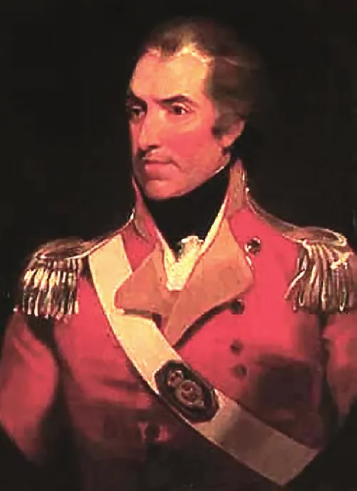

> **Уильям Патерсон (1755—1810)**
>
> Уильям Патерсон был солдатом, исследователем и вице-губернатором. Как и его добрый друг сэр Джозеф Бэнкс, Патерсон горячо интересовался ботаникой. В конце 1770-х годов Патерсон несколько раз ездил в Южную Африку, а после возвращения в Англию в 1781 году стал солдатом 98-го полка и в конце концов служил в Индии. Он постоянно поддерживал связь с Бэнксом и посылал английскому натуралисту множество образцов. Когда полк расформировали, Патерсон вернулся в Англию и стал капитаном Корпуса Нового Южного Уэльса — вероятно, с помощью Бэнкса. В Сидней он прибыл в октябре 1791 года.
>
> Следующие два с половиной года Патерсон служил на острове Норфолк, посылая образцы Бэнксу, и они обсуждали публикацию своих находок. К сентябрю 1793 года Патерсон вернулся в Сидней и задумал экспедицию в поисках пути через Голубые горы. Эта экспедиция провалилась, а в декабре 1794 года Патерсон стал временным управляющим колонией до прибытия губернатора Джона Хантера. Краткое правление Патерсона обычно считают временем, когда офицеры и солдаты Корпуса Нового Южного Уэльса богатели за счёт остальных поселенцев.
>
> В 1796 году Патерсон уехал домой в отпуск по болезни и провёл в Англии немало времени с Бэнксом, обсуждая растения и деревья; тогда же он стал членом Королевского общества. Наука была одним из главных интересов Патерсона, и, находясь за границей, он вёл с Бэнксом обширную и частую переписку. Кроме того, Патерсон был страстным собирателем ботанических образцов и за время службы в колонии привёз в Австралию несколько растений (в том числе персики).
>
> К марту 1799 года Патерсон, уже подполковник, получил приказ вернуться в Сидней, чтобы расследовать обвинения в повальной торговле спиртным среди офицеров Корпуса Нового Южного Уэльса. К ноябрю он был снова в Австралии и много времени посвящал расследованию не только истории со спиртным, но и угрозы бунта ирландских каторжников. Он также собирал растения в окрестностях Хоксбери и готовил образцы для отправки Бэнксу в начале 1800 года.
>
> Политическая роль, которую Патерсон играл как вице-губернатор в начале 1800-х годов, выходит за рамки этого «Отпускного билета», но сведения о ней легко найти в указанном ниже источнике. Стоит также заметить, что, в отличие от многих своих сослуживцев по Корпусу Нового Южного Уэльса, Патерсон, как показывают исторические документы, не был втянут в повальную коррупцию, которую расследовал в Сиднее, и умер бедным человеком.
>
> (Источник: http://adb.anu.edu.au/biography/paterson-william-2541)

## С чего начать

Приключение начинается в Парраматте, где персонажей собрали властью подполковника Уильяма Патерсона и подчинили лейтенанту Алистеру Морранту. Им приказано отправиться в глубь страны, до самых Голубых гор, найти всё, что ещё осталось от падения «падшей звезды», и доставить это Патерсону и губернатору Хантеру в Сидней. К собравшимся перед трактиром «Масонский герб» сыщикам вскоре выходит Моррант, начальник экспедиции.

Молодой офицер Корпуса Нового Южного Уэльса, несколько книжного вида, выходит из трактира в свежевычищенном мундире. Когда его впервые видят, он аккуратно складывает очки и убирает их в металлический футляр, а футляр — в льняную сумку. Он встаёт на каменную подставку для посадки на лошадь и обращается к участникам экспедиции. Позади Морранта вольно стоят четверо солдат Корпуса Нового Южного Уэльса (некоторые могут быть сыщиками, остальные — NPC).

Моррант сообщит собравшимся, что они готовятся выступить в научную экспедицию за упавшим метеоритом и что идти им предстоит быстро, по почти неизведанной…
