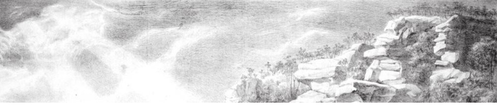

…вправе требовать от игроков успешных проверок навыков, чтобы отряд каждый день неуклонно продвигался к цели. Проваленные проверки или крахи могут означать, что отряд продвигается медленнее, чем ожидалось, или даже совсем заблудился. Учитывая скудный запас еды, который несёт отряд, долгий период блужданий может внезапно поставить экспедицию под угрозу голода — возможно, ей придётся повернуть назад раньше, пока не кончились припасы.

### День 1

В первый день экспедиция покидает Парраматту, отправляясь в поход, который, по расчётам Морранта, займёт 8–10 дней туда и обратно; он надеется проходить по 13–16 километров в день. Выйдя из Парраматты, отряд сначала встретит Беннелонга (см. выше), а затем войдёт в травяные равнины за обжитыми землями. На равнинах встречаются кенгуру, на которых можно охотиться ради пропитания.

### День 2

Пройдено 13–16 километров. Экспедиция идёт по более болотистой местности, где путь преграждают мангровые заросли и река Непин. Скорее всего, экспедиции придётся выпрячь быков и перетаскивать телеги через реку на руках.

Вечером, когда экспедиция встанет лагерем, вдалеке послышится вой голубогорских йови. Ночное небо озаряет сухая гроза, и очень далёкий треск грома не заглушает нечеловеческого воя, пока бушует гроза. Слышать этот вой страшно — требуется проверка Рассудка (0/1D3).

Когда гроза кончается, ночное небо наполняет странный синеватый свет, идущий со стороны (предполагаемого) места падения, до которого ещё много километров. С приближением рассвета синеватый свет гаснет. Сейчас у сыщиков нет никакой возможности это узнать, но это неземное свечение исходит от инопланетной растительности, расползающейся из одного из вскрытых контейнеров на месте падения метеорита.

### День 3

Пройдено 13–16 километров. Экспедиция начинает входить в поднимающиеся предгорья Голубых гор, и Моррант начинает понимать, что его карты больше не помогают. С каждым шагом экспедиция по-настоящему наносит на карту новую территорию. В полдень экспедиция выйдет к небольшому посёлку аборигенов народа гандангарра.

#### Встреча: посёлок аборигенов

Племенные старейшины и знахари общины выйдут навстречу экспедиции; их заинтересуют эти белые лица, которых мало кто в общине видел прежде. Даже если в делегации есть сыщик-абориген и/или Буррага, аборигены Голубых гор всё равно будут относиться к ним с некоторым подозрением. Впрочем, это не помешает им охотно поделиться с гостями едой и питьём. Если сыщики найдут способ свободно объясниться с членами общины (например, используя знание Бурраги разных языков), они смогут расспросить их о метеорите. Тогда старейшины и мудрецы быстро сообщат экспедиции, что молодой соплеменник по имени Джунба недавно вернулся с места падения, но он очень нездоров. Они проводят сыщиков к традиционной хижине из коры, где лежит тяжело больной юноша.

Осмотрев больного аборигена Джунбу, легко понять, что с ним творится что-то серьёзное. Его тёмная кожа светится синим отливом, белки глаз светятся таким же синим оттенком, у него жар. Под кожей видны небольшие бугорки. Однако пока Джунба в ясном сознании, хотя говорит неохотно. Если его расспросить, он расскажет, что случилось, когда его друзья нашли метеорит и начали исследовать разорённую местность.

В горячечном рассказе Джунбы сперва упоминаются несколько больших предметов «как водоносы» возле великого камня — предметы, «блестящие, как солнце на озере или как панцирь жука», но с прямыми гранями,…
