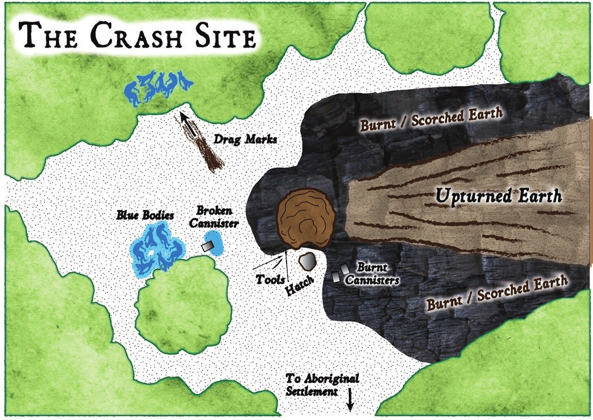

…позволит сыщикам обнаружить разбросанные по земле куски метеорита (размером с кулак и меньше) задолго до того, как они доберутся до самого места падения.

С наступлением ночи на 4-й день экспедиция наконец добирается до места падения в предгорьях Голубых гор. С ближайшего гребня, глядя вниз в долину, участники экспедиции ясно видят полосу разрушений. Хорошо виден и сам метеорит, даже в меркнущем свете. Огромный шар метеоритного камня высотой 5 метров лежит, наполовину вросший в землю. К северо-востоку вдаль тянется глубокая борозда вывороченной земли. По обе стороны от неё лежат сломанные или расщеплённые деревья, а на поляне взрывная остановка метеорита повалила деревья в круге диаметром 10 метров, разметав их от центра наружу. Хранители, видевшие фотографии последствий Тунгусского падения, могут черпать из них вдохновение, описывая эту картину.

Пролёт и удар метеорита вызвали пожары, но, поскольку здесь умеренный дождевой лес, влажная местность вскоре погасила большую часть пламени. И всё же меньше чем за две недели природа не может стереть все следы разрушения, поэтому, прибыв на место, сыщики увидят среди повреждённых деревьев и вывороченной растительности следы недолгого, но сильного пожара.

По прибытии Моррант прикажет разбить лагерь метрах в 25 от места падения. Ближний ручей даст питьевую воду для быков и экспедиции. Когда палатки поставлены и костры разведены, Моррант встретится с сыщиками, чтобы обсудить, как они будут утром исследовать место и что нужно сделать, чтобы спасти огромную оставшуюся глыбу метеорита. Моррант будет отговаривать всех от того, чтобы бродить по месту падения в темноте, но не станет мешать сыщикам (не каторжникам), если те будут настаивать на том, чтобы всё разнюхать.

Беглый осмотр места падения — а в угасающих сумерках только он и возможен — быстро натолкнётся на мёртвые тела шестерых из оставшихся здесь мужчин-гандангарра (см. ниже). Поверхностный поиск обнаружит также несколько металлических контейнеров странно правильной формы: одни вскрыты и пусты, другие целы. Они разбросаны по всему месту падения. Что было во вскрытых контейнерах, не видно никаких признаков.

**Подписи на карте «The Crash Site» («Место падения»):**

- **Burnt / Scorched Earth** — выжженная, опалённая земля (к северу и к югу от борозды).
- **Upturned Earth** — вывороченная земля (борозда падения, тянется на северо-восток).
- **Drag Marks** — следы волочения (ведут к телам в лесу на северо-западе).
- **Blue Bodies** — синие тела.
- **Broken Cannister** — разбитый контейнер.
- **Tools** — орудия (каменные орудия и копья у пролома).
- **Hatch** — люк.
- **Burnt Cannisters** — обгоревшие контейнеры.
- **To Aboriginal Settlement** — к посёлку аборигенов.

*Без подписи на карте: в центре — метеорит; на северо-западе, на опушке леса, — вторая группа синих тел.*
