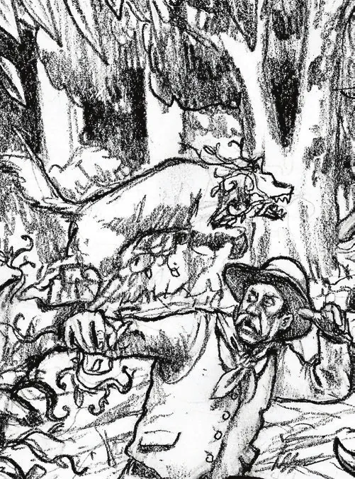

…привезти побольше странной металлической начинки и ещё куски метеоритного камня, но если его удастся убедить, что без дополнительного снаряжения больше ничего не спасти, он согласится уйти на следующее утро. В противном случае второй день на месте (6-й день) уйдёт на то, чтобы спасти всё, что ещё можно добыть, включая часть странных технических машин изнутри (все они сильно повреждены и, вероятно, не поддаются ремонту при нынешних технических знаниях).

### День 7

Как бы успешно ни прошли спасательные работы во второй день на месте падения, на рассвете 7-го дня Моррант прикажет экспедиции повернуть назад, к Парраматте, — припасы начинают подходить к концу. Моррант приказывает экспедиции вернуться прежним путём в Парраматту, пробираясь через дождевой лес и холмы назад по тропе, которую они прорубили к месту падения. Идти приходится гораздо медленнее: экспедиция проходит не больше 13 километров, да и то лишь доводя людей и скот до предела сил.

В течение 7-го дня многие участники экспедиции, скорее всего, начнут чувствовать общее недомогание — вступает в силу стадия 1 вирусной заразы.

#### Встреча: динго съели моего Старца

В начале дня, примерно через час после того, как экспедиция остановилась на обед, без всякого предупреждения нападает стая заражённых динго-мутантов. У каждого из этих омерзительных созданий из ушей, пасти и живота растут растения и лозы. Динго свирепы и обезумели от вируса, который даёт им сверхъестественную силу и приводит в исступление, если им удаётся укусить цель. Характеристики динго-мутантов — в конце сценария.

Хранителю нужно не забывать проверять заражение каждый раз, когда кого-то из экспедиции кусают эти мутировавшие твари. Если динго отогнать, они не вернутся. Каждый убитый динго падает на землю и начинает медленно растворяться: растения внутри исчерпали свои силы в этой яростной атаке. Ничего не останется, кроме светящегося синего осадка.

Когда тварей прогонят, Моррант прикажет на следующий день отнести всех раненых участников экспедиции в посёлок племени, где их можно будет оставить выздоравливать. Погибших похоронят там, где они пали. Вечером, когда экспедиция остановится на ночлег, нужно сделать проверки ВЫН на развитие вирусной болезни.

### День 8

Пройдено 13–16 километров. В полдень экспедиция ненадолго остановится в том же посёлке аборигенов, где уже побывала. Вскоре станет ясно, что большинство гандангарра покинули посёлок, оставив лишь нескольких соплеменников, которые собирают традиционную пищу, чтобы кормить переселившихся родичей. Если сыщики спросят о Джунбе, они узнают, что он умер вчера. Теперь из отверстий его тела прорастают странные синие папоротниковидные растения.

Раненых участников экспедиции можно оставить у аборигенов, но лечить их раны почти некому: все традиционные целители покинули посёлок.

Когда экспедиция покидает деревню, дневная жара становится почти невыносимой, особенно для больных и раненых. Вой голубогорских…
