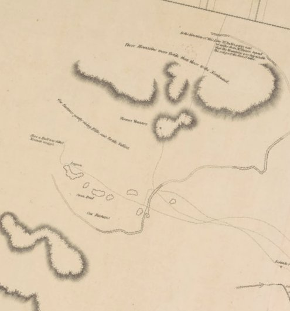

Все йови, убитые экспедицией, окажутся заражены инопланетным растительным вирусом. Однако их более крепкое сложение проявляется лишь в том, что они находятся на стадии 2, хотя заразились несколько дней назад. Если экспедиция возьмёт тело голубогорского йови как образец, той же ночью на неё нападут во второй раз — ещё четверо незаражённых йови, которые попытаются вернуть труп.

Если вторую волну йови отгонят или перебьют, на экспедицию больше не нападут. Однако вой и вопли будут слышны всю ночь — до часа перед рассветом, когда кончится гроза.

### День 10

Экспедиции будет трудно пройти намеченные 13–16 километров. Если экспедиция будет неумолимо гнать вперёд, её участники, возможно, как раз успеют к ночи добраться до Парраматты. Чтобы двигаться с такой скоростью, Хранителю следует назначить проверки навыков или характеристик (особенно для заражённых).

Вероятнее, что отряд будет продвигаться всё медленнее. Тревожнее другое: запасы еды экспедиции теперь доходят до критического уровня — отчасти потому, что часть еды портится в летней жаре. Хуже того, миазмы гниющего и растворяющегося Старца быстро портят всю незакрытую еду. Точно так же запасы свежей воды отряда могли пропитаться спорами растений — или, может быть, просто приобрели неприятный запах, из-за которого незаражённые участники экспедиции не хотят к ней притрагиваться. Моррант (если он ещё жив) будет советоваться с сыщиками, как распределить и разделить на пайки оставшуюся еду и воду.

Поздно вечером 10-го дня быки, тянущие телеги, упадут — возможно, уже в виду Парраматты. У животных явные признаки странной болезни: изо рта и ушей у них растут синие папоротниковидные побеги.

Если прото-шоггот ещё не вырвался, вероятность, что он вырвется на 10-й день, — 90%, если не было сделано ничего, чтобы охладить или укрепить контейнер. Даже если какие-то меры приняты, есть 50% шанс, что чудовищная тварь вырвется из заточения. В таком случае игрокам придётся иметь дело с вырвавшимся на волю прото-шогготом, который сразу нападёт на оставшихся участников экспедиции, а может быть, даже на жителей Парраматты.

Если Моррант ещё жив и в своём уме, учёный у вечернего костра может выступить с шокирующим предложением: возможно, говорит он, экспедиции совершенно необходимо встать на карантин, а не возвращаться в городок Парраматту (подробнее см. ниже).

### День 11

Если на 11-й день экспедиция ещё не добралась до Парраматты, Моррант решит, что экспедиция ДОЛЖНА немедленно остановиться и встать на карантин, — какие бы возражения ни вызвал его план накануне вечером. Он приказывает отряду остановиться, не доходя до городка, и оставаться там, пока болезнь не пройдёт. Большинство участников экспедиции, скорее всего, больны, а кто-то, может быть, уже мёртв. Если кто-то из сыщиков не заражён (или сумеет убедить Морранта, что здоров), им позволят пойти в городок и привести врача из больницы Парраматты.

Если среди выживших сыщиков есть военный из Корпуса Нового Южного Уэльса, его будут убеждать вернуться в казармы Парраматты и отправить весть губернатору Хантеру и подполковнику Патерсону в Сидней.

К 11-му дню от Старца останется немногим больше, чем растекающаяся слизь, если его не сохранили каким-то образом. Прото-шоггот вырвется на свободу поздно днём, перед самым закатом, если только контейнер не был И укреплён, И как-то охлаждён.

