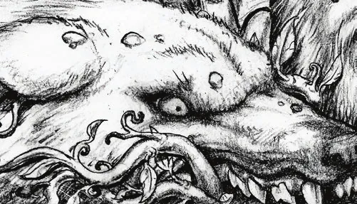

Он обратил на себя внимание Уильяма Патерсона, когда сопровождал его в неудачной экспедиции 1793 года в Голубые горы. Верность Морранта была вознаграждена: во время краткого правления Патерсона в должности исполняющего обязанности губернатора его назначили старшим помощником. В 1796 году Морранта пригласили сопровождать Патерсона обратно в Англию. Там Морранта представили сэру Джозефу Бэнксу и ненадолго отправили на остров Уайт забрать образцы, которые Бэнкс оставил там много лет назад. Теперь, вернувшись в Австралию несколько недель назад, Моррант привыкает к переменившемуся политическому климату колонии. Когда Патерсон решил отправить отряд за упавшим метеоритом, он, естественно, выбрал Морранта начальником экспедиции.

```stat
СИЛ 60    ВЫН 50    ТЕЛ 65    ЛВК 50    ИНТ 80
НАР 65    МОЩ 60    ОБР 55    Рассудок 60    ПЗ 11
БкУ: +1d4    Комплекция: 1    Скорость: 7    ПМ: 12    Удача: 45

Бой:
Драка      35% (17/7), урон 1d3 + БкУ
Карабин    55% (27/11), урон 1d10+4 [дальность 70 м;
           1 выстрел за 4 раунда; осечка 95+]
Уклонение  55% (27/11)

Навыки: Средства 65%, Проницательность 55%, Запугивание 45%,
Слух 45%, Естествознание 50%, Наука (ботаника) 35%,
Скрытность 40%, Внимание 55%.
```

## Буррага

*Проводник-абориген, 21 год.*

Буррага — дальний родственник Беннелонга, одного из самых знаменитых вождей коренных общин Австралии. Последние полгода или около того Буррага живёт в Парраматте и её окрестностях, хотя впервые встретил своего «дядю» Беннелонга ещё в 1795 году, когда тот вернулся из Англии. С тех пор Буррага несколько раз в месяц ходит из буша в колонию, принося новости в обе стороны. Буррага служил проводником некоторым местным поселенцам и готов делать это за хорошую плату. Хотя он обожает слушать рассказы о далёких странах, Буррага считает, что большинство европейцев не прожили бы в буше и недели, и потому старательно скрывает презрение к тем, кто, по его мнению, погиб бы без его помощи.

```stat
СИЛ 60    ВЫН 65    ТЕЛ 65    ЛВК 65    ИНТ 70
НАР 50    МОЩ 65    ОБР 65    Рассудок 60    ПЗ 13
БкУ: +1d4    Комплекция: 1    Скорость: 8    ПМ: 13    Удача: 60

Бой:
Драка               55% (27/11), урон 1d3 + БкУ
Лёгкое копьё        65% (32/13), урон 1d6+1 + БкУ
Метательное копьё   65% (32/13), урон 1d6+1 + ½ БкУ [дальность 24 м]
Уклонение           50% (25/10)

Навыки: Средства (у европейцев) 10%, Иностранный язык (английский) 30%,
Иностранный язык (язык аборигенов окрестностей Сиднея) 50%, Слух 70%,
Тайные знания (аборигенов) 50%, Ориентирование 65%, Выживание (буш) 50%,
Метание 65%, Чтение следов 65%.
```

## Стая динго-мутантов

*В стае 2D3 динго; для каждого используйте одни и те же характеристики.*

```stat
СИЛ 70    ВЫН 55    ТЕЛ 35    ЛВК 70    МОЩ 35
ПЗ 12
БкУ: нет    Комплекция: 0    Скорость: 12    ПМ: 7

Бой:
Атак за раунд: 1
Ближний бой  50% (25/10), урон 1d6 + заражение
Уклонение    40% (20/8)

Бешенство: если динго-мутант успешно укусил и нанёс урон, он вцепляется
в цель и в следующем раунде впадает в бешенство. Сделайте встречную
проверку СИЛ; если динго выиграл, он автоматически наносит ещё 3 пункта
урона каждый раунд, пока держится за жертву.

Заражение: всякий, кого укусил динго-мутант, может заразиться тем же
вирусом; см. «Инопланетный растительный вирус» на с. 16.

Навыки: Слух 75%, Чтение следов по запаху 85%.
Броня: 1 пункт (шкура); однако огонь игнорирует броню и наносит двойной урон.
Потеря Рассудка: 0/1d6 Рассудка — увидеть динго-мутанта.
```

*Прим. перев.:* ПЗ 12 не сходятся с ВЫН 55 и ТЕЛ 35 (по правилам выходит 9) — оставлено как напечатано.


