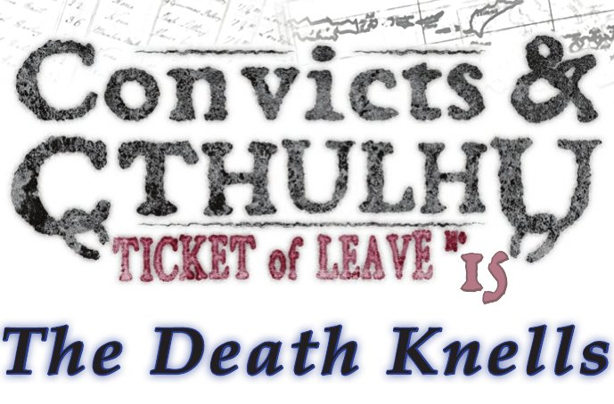
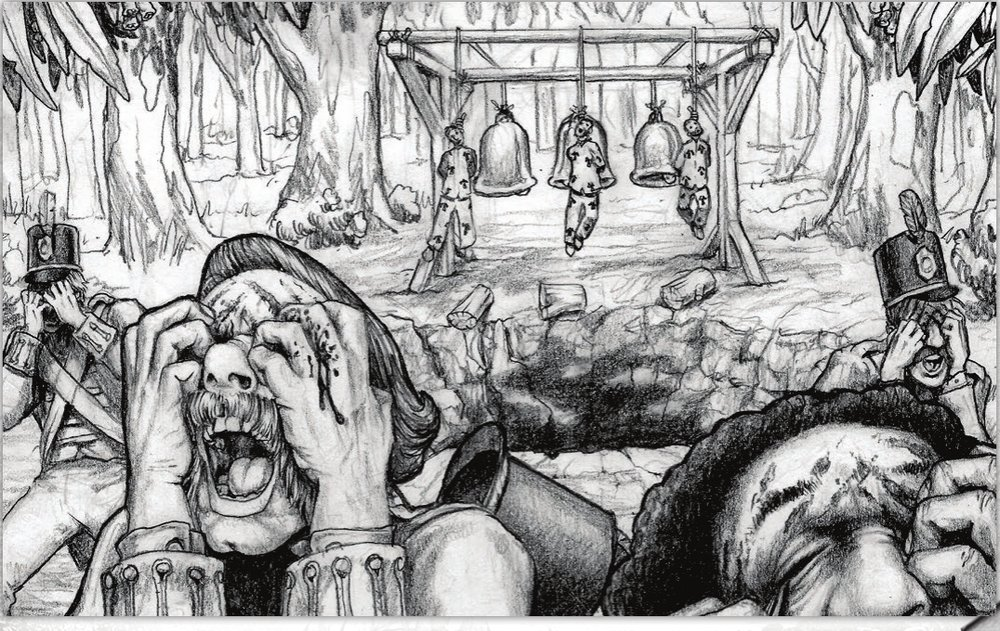

ПОХОРОННЫЙ ЗВОН

Convicts &amp; Cthulhu — Отпускной билет № 15

*Вверху страницы — логотип «Convicts & Cthulhu — Ticket of Leave № 15» и заглавие «The Death Knells» («Похоронный звон») на фоне старинных рукописей.*

> «Отпускные билеты» (Tickets-of-Leave) — небольшие самостоятельные дополнения к сеттингу «Convicts & Cthulhu» для лавкрафтовских ролевых игр в ранних каторжных колониях Австралии. В каждом — подборка игровых элементов: их можно использовать все вместе как набросок мини-сценария или по отдельности — как детали, которые обогатят сценарий вашего собственного сочинения.

> **Выходные данные**
>
> «Отпускной билет» № 15 написали Дин Энгельхардт (Dean Engelhardt) и Джефф Гиллан (Geoff Gillan); оригинальные иллюстрации — Рубен Додд (Reuben Dodd). © 2019. Издатель — Cthulhu Reborn Publishing (www.cthulhureborn.com).
>
> Сеттинг «Convicts & Cthulhu» издаёт Cthulhu Reborn Publishing; он доступен на RPGNow и DrivethruRPG по модели «Плати сколько хочешь» (Pay-What-You-Want).
>
> *Из-за лицензионных ограничений эта версия PDF «Отпускного билета» — «без статов» (unstatted): в ней опущены все упоминания конкретных ролевых систем, игровая механика и характеристики. Отдельную версию того же PDF «со статами» (statted), с подробными характеристиками для старейшей лавкрафтовской ролевой игры, можно бесплатно скачать прямо с сайта Cthulhu Reborn (www.cthulhureborn.com/download).*
>
> Лицензия Creative Commons BY-NC-SA.

# Вступление

Музыка была неотъемлемой частью жизни каторжной эпохи. Это и музыка и танцы первых народов Австралии, и военная музыка, которая будила каторжника и снова отправляла его или её спать, и каторжные баллады, которые пели или играли на скрипке и других инструментах, и музыка состоятельных колонистов (в колонии было на удивление много фортепиано). В этом пятнадцатом «Отпускном билете» мы рассматриваем музыку каторжной эпохи и предлагаем приключение, в центре которого — каторжная рабочая песня, которая может оказаться предвестием гибели Колонии.

## Музыка каторжной эпохи

> *«Невинность и те благородные начала свободы, что я всегда лелеял, заставляют меня играть на скрипке среди этих прелестных лесных видов и т. д.…»*
>
> — **Каторжник-джентльмен Джон Грант на реке Парраматта, 1804 год; цитируется по: Robert Jordan, *Music and civil society in New South Wales, 1788–1809*.**

Этот «Отпускной билет» рассматривает музыку каторжной эпохи между 1788 и 1809 годами — периода основного сеттинга «Convicts & Cthulhu». Речь пойдёт главным образом об инструментальной музыке, а не о песнях и балладах.

