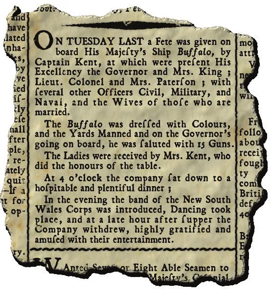

## Другая военная музыка

Оркестр был не единственной военной музыкой в колонии. Барабаны поднимали жителей колонии с постелей на рассвете и били «тапту» ночью, возвещая отбой. (Этот комендантский час в 1803 году был установлен на 8 часов вечера, а к декабрю 1803 года — на 9 часов вечера.)

Барабаны служили и часами для всех жителей Сиднея: в час дня регулярно бил барабан. С 1796 года для созыва людей и отсчёта времени использовали также колокола, а с 1800 года в Сиднейской гавани на видном месте висел колокол.

> **Загадка колоколов интендантства**
>
> Первый священник Сиднея, преподобный Джонсон, постоянно враждовал с Корпусом Нового Южного Уэльса, особенно с вице-губернатором Гроузом. Преподобный привёз из Англии маленький колокол, чтобы созывать каторжников и горожан на молитву, но тот был слишком мал для тех расстояний, которые ему нужно было покрыть, и его плохо было слышно.
>
> Джонсон полагал, что в интендантстве хранятся и другие колокола, но они «нужны для иных целей», и получить их он не мог. Что это были за «иные цели», так толком и не объяснили, но просьбы выдать эти колокола из Казённого интендантства отклонялись.
>
> Пока шёл этот спор, Джон Хантер (вскоре ставший постоянным преемником временно исполнявшего обязанности Гроуза) заказывал для колонии ещё восемь колоколов. Они предназначались в качестве рабочих колоколов для каторжных бригад. Почему для этого нельзя было взять колокола, хранившиеся в интендантстве, тоже не объяснили.
>
> После того как Хантер стал губернатором (в 1795 году), колокола начали появляться в разных местах колонии, но никто не мог сказать, новые ли это колокола, заказанные Хантером (быть может, кем-то украденные по прибытии в колонию), или загадочные колокола интендантства.
>
> Изобретательный Хранитель, несомненно, сумеет превратить эту историческую странность в поворот сюжета жуткого сценария (что и сделано в сценарии, составляющем вторую половину этого «Отпускного билета»).

> **Вырезка из «Сидней газетт» (1803)**
>
> В ПРОШЛЫЙ ВТОРНИК на борту корабля Его Величества «Буффало» капитан Кент дал праздник, на котором присутствовали Его Превосходительство губернатор и миссис Кинг, подполковник и миссис Патерсон и несколько других офицеров гражданской, военной и морской службы с жёнами тех, кто женат.
>
> «Буффало» был украшен флагами, на реях выстроены матросы, а при восхождении губернатора на борт был дан салют из 15 орудий.
>
> Дам принимала миссис Кент, исполнявшая обязанности хозяйки стола.
>
> В 4 часа общество село за радушный и обильный обед.
>
> Вечером был приглашён оркестр Корпуса Нового Южного Уэльса, начались танцы, и поздно, после ужина, общество удалилось, весьма довольное и развлечённое.

*Ниже на вырезке виден обрывок соседнего объявления: «Требуются восемь или более крепких моряков…».*

## Гражданская музыка

Фортепиано (pianoforte — так официально называлось то, что мы зовём пианино) привезли с Первым флотом; оно принадлежало корабельному хирургу Джорджу Уоргэну. В конце концов это фортепиано досталось Элизабет Макартур, жене Джона Макартура (см. основную книгу «Convicts & Cthulhu»), которую Уоргэн учил играть. Фортепиано было популярным инструментом у богатых и свободных поселенцев, как и скрипка. Губернатор Хантер сам был скрипачом и порой играл в обществе. Скрипка — чаще всего упоминаемый инструмент каторжников и бывших каторжников, и скрипачи из каторжников могли подработать игрой. Зарабатывать они могли и как уличные музыканты или трактирные исполнители. Другим популярным инструментом была флейта.

Гражданская музыка звучала на всевозможных собраниях, в том числе на танцах и свадьбах.

Церковная музыка тоже была важной частью европейской жизни в каторжную эпоху. Несмотря на трения между Корпусом Нового Южного Уэльса и представителями церкви, некоторые солдаты пели в хорах, исполнявших гимны в церквях. Хоры собирались на спевки дважды в неделю. Ко времени Маккуори (сразу после эпохи «Convicts & Cthulhu») приезжие отмечали, что они очень хороши. Органная музыка звучала после 1803 года.

Ещё один ценимый в колонии хор — хор Сиротской школы для девочек (см. «Отпускной билет» № 9 «Orphan School Horror»); кроме того, музыку можно было услышать в популярных театрах Сиднея.
