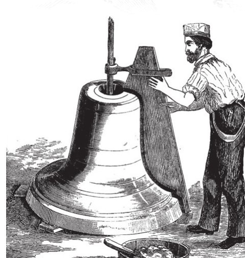

## Как вовлечь сыщиков

Сыщики вступают в этот сценарий, когда их просят выяснить, кто совершил ужасные ночные убийства ночных сторожей у Сиднейской гавани. Власти хотели бы также знать, зачем кому-то понадобилась такая на первый взгляд бессмысленная череда убийств.

Обратиться к сыщикам могут по разным причинам:

- Они сами могут быть членами Ночной стражи (см. «Отпускной билет» № 1 «Ночные ужасы»), которым, естественно, не терпится узнать, кто убил их товарищей.
- Они могут быть солдатами Корпуса Нового Южного Уэльса, которым главный профос или кто-то другой поручил расследовать преступления.
- Они могут быть людьми, которые уже показали себя знатоками необычных и жутких дел.
- Они могут быть каторжниками, распределёнными в любую из перечисленных групп.
- Они могут быть следопытами-аборигенами, которые славятся тем, что могут выследить кого угодно.

В зависимости от того, как сыщики вступают в игру, Хранителю, возможно, придётся сымпровизировать короткую сцену, в которой им официально поручают раскрыть тайну Портовых удушений. Им сообщат только, что все три преступления произошли у гавани, что при этом было достаточно шума, чтобы насторожить работавших поблизости ночью людей, и что в Портовом колоколе остался торчать ручной топор.

## С чего начать: трое мёртвых

Скорее всего, сыщики начнут с осмотра мест на берегу гавани, где произошло насилие. Места убийств разбросаны примерно в 200 метрах друг от друга. Хранитель волен расположить их где угодно в окрестностях Правительственной пристани. В центре их всех — Портовый колокол, который стоит возле пристани.

В каком бы порядке сыщики ни посещали места убийств, там можно обнаружить следующие сведения. Хранителю решать, где нужны проверки навыков; в некоторых случаях сведения очевидны любому, кто побывает на месте.

**На первом осмотренном месте:**

- Следы на шее мёртвого ночного сторожа говорят о том, что его задушили.
- Признаков драки нет, и нож сторожа остался в ножнах — видимо, нападавший застал его врасплох.
- Рядом с телом брошена на землю полоса кожи, скрученная в некое подобие удавки или петли.
- Чтобы задушить человека таким самодельным оружием, нужна большая физическая сила.
- Кожа такого сорта, какой обычно продают для пошива сапог и башмаков, хотя этот кусок явно вырезан из плоского листа.
- В карманах убитого есть ценные вещи, в том числе медальон и долговая расписка на 1 шиллинг; значит, ограбление не было мотивом.
- С пояса убитого, похоже, что-то сняли [*Примечание для Хранителя:* это был ручной колокольчик, который он носил с собой].
