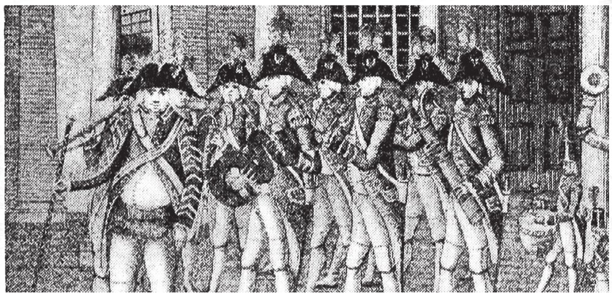

- Несколько человек выбежали из школы и увидели лишь нескольких мужчин на телеге, которая тут же умчалась вниз по склону к Роксу.
- На земле остался мёртвый каторжник, которого, очевидно, раздавило немалым грузом. Его опознали: он из рабочей бригады, которую днём посылают дробить камень у гавани, но у которой есть и разрешение на ограниченные ночные работы под надзором.
- Поискав в Доме правительства, можно найти бумаги, из которых видно, что эта бригада постоянно приписана к Чарльзу Седжвику.

Если сыщики наведут справки об этом происшествии в Сиротской школе для девочек, они могут найти тех самых очевидцев, которые подтвердят официальный рассказ.

## Комиссариат

Усердные сыщики могли узнать о рассказах про колокола, хранящиеся в Комиссариате. Этих сведений Мэтью Седжвик так и не узнал (а они, быть может, изменили бы его поступки).

Когда сыщики придут в Комиссариат, на их вопросы поначалу лишь озадаченно заулыбаются рядовые солдаты, которые принимают повседневные заявки. Эти люди явно ничего не знают. Сыщики, которые потребуют встречи с кем-то из начальства, вскоре окажутся в обществе «Малыша Джека» Палмера, который больше десяти лет служит правительственным комиссаром.

Палмер — сам человек богатый и видная фигура сиднейского света — сначала спросит, зачем сыщикам знать о содержимом казённых складов. Если они смогут привести вескую причину, Палмер уклончиво признает, что на казённых складах действительно уже несколько лет лежат три больших медных колокола. Убедительный сыщик дальнейшими расспросами выведает кое-что о том, почему эти колокола так и не выдали: они бракованные, практически бесполезные. Колокола — своего рода позор колонии: их изъяны подчёркивают, что Колониальное ведомство обращается с Новым Южным Уэльсом как со свалкой для негодных вещей, которым не нашлось лучшего применения.

Особенно убедительные сыщики могут уговорить Палмера показать им колокола, запрятанные в самой глубине склада Комиссариата. Он поведёт их в самый дальний угол большого здания и велит двум дюжим солдатам отодвинуть несколько ящиков, загораживающих колокола. Однако, когда ящики отодвинут, Палмер громко ахнет: «Колокола — их нет!» Все остальные в Комиссариате, кого видят вокруг себя сыщики, потрясены этим открытием ничуть не меньше. Если сыщики спросят, когда колокола могли унести, Палмер скажет, что узнать это никак невозможно: никто ничего не брал из этого пыльного угла уже несколько месяцев, а то и лет.
