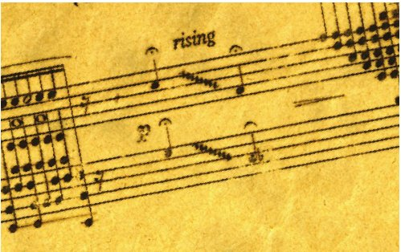

его ночных занятий или наводит на мысль, что сыщики узнали об открытии Мэтью, убедит Чарльза, что сыщики могут быть угрозой. Хотя в разговоре с ними он не выдаст себя и сохранит внешнее спокойствие, едва расспрашивающие уйдут, безумец начнёт обдумывать, как их обезвредить (некоторые мысли — в следующем разделе).

## Обыск вещей Чарльза

Чарльз живёт в здании казарм Корпуса Нового Южного Уэльса, поэтому возможность спокойно обыскать его вещи зависит от того, насколько свободно сыщики могут входить в это здание и выходить из него (для других солдат и военных это легко, для прочих — труднее). Скорее всего, понадобится кто-то, кто покажет им, где спит Чарльз: ничем не примечательная койка с потрёпанным морским сундуком в ногах. Обыскав сундук, сыщики найдут драгоценную флейту Чарльза (если только он сейчас не на репетиции оркестра), но больше почти ничего интересного.

Особенно наблюдательные сыщики найдут потайной ящик, спрятанный в основании сундука. В нём пачка бумаг, сплошь исписанных нотными станами, расчерченными от руки и заполненными мешаниной нот. Это сочинения Чарльза — сольная пьеса для флейты, которая должна сопровождать его ритуал призыва. Любой сыщик, знающий музыку (успех соответствующего навыка), определит, что мелодия совершенно неправильная — атональная какофония. Если кто-то сумеет сыграть один из этих напевов на флейте, он придёт к тому же выводу, а каждый, кто будет слушать исполнение, испытает лёгкое потрясение. Сыщики, знакомые с Мифами Ктулху, вспомнят, что такую музыку, по слухам, исполняют при дворе Демонического султана Азатота.

# Что дальше?

Когда сыщики закончат первоначальное расследование, ход сценария будут определять два обстоятельства: действия сыщиков и ответные действия Чарльза Седжвика.

Ниже даны советы для некоторых возможных положений:

1. Возможно, сыщики будут довольны тем, что раскрыли тайну, кто убил ночных сторожей, и доложат, что их работа окончена. В таком случае, если только они потом не решат распутать оставшиеся концы, у Чарльза будут развязаны руки, и он беспрепятственно закончит приготовления. Одним осложнением станет усиленная бдительность Ночной стражи вокруг Сиднейской гавани — и это окажется отнюдь не умозрительной трудностью (см. «Холодная участь» ниже). Когда в Сиднейской гавани всплывёт замёрзший труп каторжника — смерть, поразительно похожая на смерть Мэтью Седжвика, — сыщиков может снова затянуть в дело, которое они считали уже раскрытым.
2. Если у сыщиков останутся подозрения насчёт побуждений Чарльза Седжвика, они могут решить, что незаконченных дел хватает, чтобы продолжить расследование и проследить за его ночными передвижениями. Они могут заняться этим официально (например, вызвавшись в одну из новых групп Портовой ночной стражи) или предпочесть держать свои действия в тайне. Как это может развиваться, см. «Слежка за Чарльзом и его каторжной бригадой» на с. 16.
3. Возможно, при первой встрече с Чарльзом — или позже — сыщики дадут безумцу достаточно понять, что подозревают его, и он решит, что их нужно уничтожить, иначе его замысел не удастся. В первый день или около того после бойни, устроенной Мэтью, это, скорее всего, будет ночной визит каторжника с ножом. Впрочем, может явиться и Живая Ночная Тень (особенно если Чарльз очень встревожен). Со временем его возможности растут: примерно каждую ночь у него появляется ещё одна Живая Ночная Тень (по мере того как он покрывает надписями очередной колокол), а после встречи с Портовой ночной стражей у него появляются два
