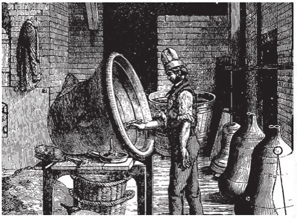

подчинённых его разуму солдата Корпуса Нового Южного Уэльса. Чтобы провести сверхъестественное нападение, см. характеристики Ночных Теней на с. 22; более обыденное нападение Хранителю следует сымпровизировать. Особенно охотно Чарльз будет использовать своих пешек из Корпуса, чтобы осложнять сыщикам жизнь в дневные часы.

## Холодная участь

Что бы ни случилось, Чарльз Седжвик не прекратит приготовлений к ритуалу у реки Джорджес. Даже появление множества новых особых портовых ночных сторожей не замедлит его ночной деятельности — и, по правде говоря, заметят его ночные хождения туда-сюда — лишь вопрос времени.

Однажды ночью (на выбор Хранителя) это и происходит. Трое сторожей — два солдата Корпуса Нового Южного Уэльса и каторжник — замечают, как Чарльз крадучись пробирается по кварталу у Рокса. Вместо того чтобы задержать его, они следуют за ним внутрь склада, который он снял для временного хранения колоколов (см. «Склад Чарльза в Роксе» на с. 17). Внутри с тремя сторожами быстро расправляются: Чарльз вызывает Живую Ночную Тень, чтобы убить каторжника, а на солдат Корпуса наводит чары (и применяет гипноз), подчиняя их своей воле. Ночная Тень мгновенно замораживает каторжника; первый приказ Чарльза подчинённым солдатам — отнести труп к воде и сбросить его в гавань.

Наутро замёрзший труп находят моряки и сообщают властям. Если сыщики считали дело уже раскрытым, их, вероятно, удивит, когда их попросят объяснить появление этого нового трупа.

Осмотр замёрзшего каторжника покажет, что он умер той же странной смертью, что и Мэтью Седжвик. По рассказам о том, где нашли тело, можно примерно определить, где умер этот человек, — где-то у ряда складов вдоль портового квартала Рокс.

С этого момента Чарльз будет крепко держать в своей власти разум двух солдат Корпуса Нового Южного Уэльса — энсина Джона Кеттла и рядового Каллума Макаллистера, — полагая, что их положение в колонии (а может, и их сила) пригодятся ему, чтобы отваживать врагов и довести ритуал до конца.

## Слежка за Чарльзом и его каторжной бригадой

Сыщики могут и сами решить затаиться в доках после наступления темноты в надежде заметить незаконные или подозрительные действия Чарльза или кого-нибудь из его каторжников. Успех этой тактики зависит от того, насколько хорошо они знают места, где бывает бригада Чарльза. Если сыщики знают только, что искать надо рядом с Правительственной пристанью, им понадобится немного удачи, чтобы заметить добычу. Если же они нацелятся именно на ряд складов в Роксе, успех обеспечен — при условии, что они готовы просидеть в засаде пару часов.

Когда сыщики заметят Чарльза или кого-нибудь из его людей, те будут двигаться с явным намерением остаться незамеченными: держатся в тени и то и дело оглядываются, нет ли сторожей. Чтобы проследить за кем-то из них до места назначения, нужно, чтобы хотя бы у одного из группы наблюдательность была выше, чем скрытность добычи. Успех сыщика означает, что группа бесшумно проследила за этим человеком до самого склада Чарльза и видела, как он вошёл внутрь.

Если у сыщиков есть официальная, законная причина находиться на пристанях после наступления темноты, им не нужно беспокоиться, что их обнаружит вечно бдительная Портовая ночная стража. Если же они там незаконно, им придётся раз в час проверять Скрытность, чтобы избежать патрулей. Если их обнаружат, их задержат и отведут в тюрьму, а наутро им предстоит ответить на множество неприятных вопросов.
